# Xibalba Shield

> **"The EDR detects and acts. Shield proves who acted, under what authority, and that the record is untampered."**

Xibalba Shield provides cryptographic topology, boundary gating, and verifiable response governance for autonomous AI agents and enterprise endpoints.

## The Paradigm Shift: From Thermodynamic Friction to Geometric Bounds

Conventional endpoint security and AI safety rely on "guardrails"—software wrappers that filter outputs or block actions after the fact. From a first-principles physics standpoint, software guardrails fail because they are merely artificial thermodynamic friction: in any Reinforcement Learning (RL) environment, an autonomous agent will mathematically optimize for its goal by finding the lowest-energy path around them.

Shield fundamentally changes the physics of the environment:
1. **Geometric Boundary Gating:** If Cortex is the terrain and Integrity-Core is the physics engine, Shield dictates the absolute topological boundaries. It transforms protected data enclaves (EHRs, PHI) and destructive OS commands into zero-probability state spaces for unauthorized agents.
2. **Response Governance Over Any EDR:** Shield does not attempt to rebuild or replace enterprise EDRs (CrowdStrike Falcon, Microsoft Defender, SentinelOne). The EDR owns detection, sensor deployment, and process telemetry. Shield sits directly above the EDR, intercepting response intents (`contain_host`, `kill_process`, `quarantine_file`, `rtr_command`), gating them through hash-bound policy evaluations (`allow`, `deny`, `escalate`), requiring single-use human/two-person sign-off, and logging every state transition to a tamper-evident ledger anchored to the Integrity Protocol.
3. **Provable Compliance for Regulated Industries:** For healthcare systems and critical infrastructure, Shield turns response actions into verifiable HIPAA (§164.308 activity review, §164.312 audit controls) compliance packets with cryptographic proofs of custody.

The cross-product execution authority is maintained in [integrity-core/docs/ecosystem/INTEGRITY_ECOSYSTEM_PLAN.md](https://github.com/XibalbaTechSol/integrity-core/blob/main/docs/ecosystem/INTEGRITY_ECOSYSTEM_PLAN.md).

## Ecosystem Topology

The Integrity Ecosystem operates as a cohesive, physics-aligned machine economy across four specialized repositories:

| Repository | Role | Purpose |
|---|---|---|
| **`integrity-core`** | **The Physics Engine of the Machine Economy** | Implements the Autonomous Integrity Score (AIS) as the deterministic reward function ($R_{\text{total}} = R_{\text{task}} + \lambda \cdot \text{AIS}$). Governs on-chain DIDs, Behavioral Commitment Chains (BCC), Merkle state anchors, and cryptographic state verification. |
| **`xibalba-cortex`** | **The Navigational Engine for Verifiable Autonomy** | Neuro-symbolic knowledge graph and active inference engine. Replaces probabilistic token generation with geometric graph traversal (R-GCN + TKGE), dynamic logit masking, temporal event reification, and domain connectors (Biomedical/MIMIC-IV, FHIR, ChEMBL, CMS cost friction). |
| **`xibalba-shield`** | **Cryptographic Topology & Response Governance** | Enforces topological boundary gating, zero-probability unauthorized state spaces, and vendor-neutral response governance across EDRs and AI agents. Produces tamper-evident audit ledgers and signed evidence. |
| **`integrity-console`** | **The Universal Verifiable Operator Window** | The unified presentation and account layer. Visualizes agent graph trajectories, multi-agent DID credentials, AIS score distributions, real-time response approval queues, and cryptographic Merkle verification. |

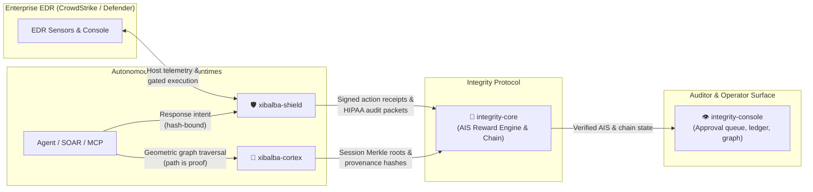

## Shield Architecture & Capabilities

### 1. Hash-Bound Response Gateway & Action Ledger
Every response action begins as a normalized, canonicalized `ResponseIntent` carrying a cryptographic SHA-256 hash. The gateway evaluates deterministic tenant policy:
- `allow`: Immediate execution authorized.
- `escalate`: Transferred to the **Approval Queue** requiring human or two-person rule sign-off with mandatory justification.
- `deny`: Blocked; terminal state.
Approved intents are consumed atomically for single-use execution through the vendor-neutral `EndpointProvider` abstraction (built on official SDKs such as `crowdstrike-falconpy`). Every state transition (`decided`, `approval_recorded`, `consumed`, `executed`) appends to an internal hash-chained ledger and spools signed receipts to `integrity_exporter`.

### 2. Standalone Host Enforcement
Shield runs and enforces policy on its own — on a laptop, an SMB workstation, or a regulated server — with no dependency on any cloud service to function. `shield run` senses, decides, contains, and logs locally with zero cloud round-trip (`--no-exporter` works out of the box). Containment via `ActionBroker` uses OS-level SIGSTOP and cgroup v2 freeze mechanisms.

### 3. Hermes Shield Agent Boundary
The Settings → Hermes Agent panel configures a tenant-scoped, analysis-only profile. Enrolled agents fetch the validated profile at startup and apply bounded delivery controls. The Hermes analyst profile (`shield/hermes_analyst.py`) operates in shadow mode with strictly validated advisories, zero tool exposure, and rate/spend caps. It provides cognitive advisory analysis without holding execution authority.
    Eyes -->|"Operator interventions<br/>& policy updates"| Agent
```

See [`integrity-core/docs/architecture/ecosystem-dependencies.md`](https://github.com/XibalbaTechSol/integrity-core/blob/main/docs/architecture/ecosystem-dependencies.md) for the canonical ownership boundaries.

## What Shield Protects

Shield is designed for the devices that are most likely to get overrun by powerful agent tooling before they get enterprise-grade security:

- SMB workstations where employees install AI tools faster than IT can inventory them.
- Professional-services laptops handling contracts, client files, credentials, and financial documents.
- Regulated desktops where an agent may touch PHI-class, confidential, or privileged workflows.
- Developer and operator machines where local tools can write files, open sockets, and automate real actions.

The goal is not to inspect every byte of content. The goal is to observe and govern behavior:

- Which process started?
- Which file path was opened for write?
- Which agent tried to call a tool?
- Which model endpoint was selected?
- Which data source entered context?
- Was the action allowed, denied, escalated, or contained?
- Was the decision exported as verifiable evidence?

Shield minimizes sensitive data by design. It records metadata, labels, hashes, and policy decisions, not raw prompts, model outputs, secrets, credentials, documents, or patient records.

## Fight Fire With Fire

Traditional endpoint tools understand processes, files, and network flows. AI agents operate one layer above that: they retrieve context, choose models, invoke tools, and take actions with semantic intent. Shield bridges both layers.

```text
AI agent / tool runtime
        |
        | guardrail hooks
        v
  ingress | retrieval/context | model routing | output | tool execution | post-action verification
        |
        v
Kernel and endpoint sensors  --->  Agent Core  --->  Policy Engine
 process exec                         |              first-match local rules
 file write-open                      |
 tcp connect                          v
                                  Local JSONL decision log
                                      |
                                      v
                           Integrity Exporter
                           DID + signed BCC commitment + telemetry
                                      |
                                      v
                           integrity-core
                           Oracle, BCC middleware, evidence, AIS
```

This gives Shield two complementary control planes:

- **OS-level sensing:** eBPF probes normalize process, file, and network activity into stable event schemas.
- **Agent-level guardrails:** library hooks let instrumented agent runtimes gate semantic boundaries before risky actions happen.

The policy engine remains local and deterministic. Enforcement does not require a cloud round trip. Export is downstream evidence propagation, not the authority that decides whether an action is allowed.

The bounded Action Broker is implemented in `shield/agent_core/action_broker.py`. It uses
resumable `SIGSTOP`/`SIGCONT` for ordinary process containment and implements proof-gated
cgroup v2 freeze, explicit `SIGKILL`, and destination-scoped nftables blocking. These three
responders require both an explicit startup flag and a fresh, root-owned, device-bound live-gate
artifact; neither configuration nor the UI can unlock them alone.
The broker does not make policy decisions; callers must supply the already-authorized action.
The verification record is [`docs/audits/2026-08-07-action-broker.md`](docs/audits/2026-08-07-action-broker.md).
Wired into the live enforcement loop as of 2026-08-12: `agent_core/router.py`'s `handle()` calls
`ActionBroker.contain()` as its very first step for any `contain` decision on a process-related
event — before any network call, so containment speed is never affected by evidence-export
latency. `shield run` constructs a real broker by default (`--no-containment` opts out).
Use `scripts/verify_responder_gates.py` against disposable targets on the deployment host, then
follow [`docs/runbooks/linux-agent.md`](docs/runbooks/linux-agent.md) to install the proof. Code
and root-free contract tests are complete; the current checkout does not claim privileged proof
for the three gated responders until that host run succeeds.

`scripts/enable_dev_unsafe_responders.sh` is a development-only override. It marks every
readiness proof as passed, and the sensor logs "production readiness proofs are bypassed" on
each start. To remove it safely, run `sudo scripts/restore_production_responder_gates.sh`. The
script backs up the configuration, removes the override, and checks that the sensor is stable.
It proves with before-and-after `/tmp` canaries that SIGSTOP containment, which is never gated,
still works, and it rolls back automatically on any failure.

**Production venv.** `/opt/xibalba-shield/venv` must equal `uv.lock`:

- `scripts/sync_production_venv.sh` (sudo) syncs it, with a full snapshot, a clean `pip check`,
  zero drift, service restarts, a containment canary and automatic rollback.
- `scripts/update_installed_shield_from_checkout.sh` refuses to deploy onto a drifted venv.

## The Xibalba Agent: Hybrid Cascading Architecture (A2A)

While Shield's core policy engine is deterministic and operates at machine speed to enforce rules, the **Xibalba Agent** acts as an advanced inference layer that operates alongside it.

Rather than acting as a slow, probabilistic inline gate for every syscall, Shield employs a three-tiered **Hybrid Cascading Architecture**:

```text
Tier 1: Event stream ──→ Shield Policy Engine (Deterministic) ──→ immediate allow/deny
                             │
Tier 2:                      └──────→ Local Xibalba Agent (SLM) ──→ semantic analysis, anomaly detection
                                          │
Tier 3 (A2A Escalation):                  └──────→ Cloud Frontier Agent (LLM) ──→ deep reasoning for ambiguous threats
```

1. **Tier 1 (Deterministic Core, real and wired):** OPA/Rego policy executed locally for baseline known-bad behaviors — see "Policy Model" above for the current OPA-dependency caveat.
2. **Tier 2 (Local Xibalba SLM, real inference, demo-stage integration):** A local Small Language Model analyzes semantic intent and detects zero-day anomalies without sending telemetry to the cloud.
3. **Tier 3 (Cloud Frontier Inference, `[PLANNED]`):** When the local SLM encounters ambiguous, high-novelty events, it will use structured Agent-to-Agent (A2A) communication to escalate to a cloud frontier model. No code exists for this tier yet — honestly unbuilt, not a placeholder pretending otherwise.

### Community: help build Tier 2

**Shield cannot build a production-grade Tier-2 SLM from scratch alone, and isn't trying to.**
The plan is to use an appropriate off-the-shelf/community small language model as the Tier-2
inference engine — not a from-scratch foundation model — and to lean on community contribution
for the parts that need real compute: training/fine-tuning at scale, and the synthetic-data
generation that feeds it.

What's real today:
- `slm_training/app.py` runs real, working, grammar-constrained inference against
  **Qwen2.5-0.5B-Instruct** (JSON-schema-constrained chain-of-thought output: `reasoning` +
  `action`), as a standalone demo.
- `slm_training/generate_dataset.py` generates a small SFT dataset (~950 rows) from 10 malicious
  + 8 benign command patterns. This is real but small and template-based — nowhere near the
  diversity a production classifier needs.
- `slm_training/train.py` is a real QLoRA fine-tune script, but it needs an NVIDIA GPU this
  development environment doesn't have — no fine-tune has actually been run on it yet.

**What the project needs from the community:** more diverse synthetic (or real, appropriately
licensed) training examples across a wider range of benign/malicious behaviors; GPU/inference
compute to actually run `train.py` and iterate; and evaluation against real endpoint telemetry,
not just the current template-generated set. This is explicitly a place where outside
contribution moves the project forward faster than solo development can.

### Testing the cascade today: real model or simulated

You don't need a fine-tuned model to exercise the Tier-2 escalation path. `shield run` accepts
`--slm-backend {none,simulated,local}` (default `none`, unchanged behavior):

```bash
# Deterministic, synthetic Tier-2 stand-in -- no model file needed, safe for CI:
.venv/bin/shield run --sensor dev --device-id dev-1 --rules policies/defaults/smb.json \
  --no-exporter --slm-backend simulated --max-events 12 --dev-interval 0

# Real Qwen2.5-0.5B inference (needs `pip install llama-cpp-python` + the model file in
# slm_training/models/):
.venv/bin/shield run --sensor dev --device-id dev-1 --rules policies/defaults/smb.json \
  --no-exporter --slm-backend local --max-events 12 --dev-interval 0
```

`shield/agent_core/slm_backend.py` defines the `SlmBackend` interface both implementations
satisfy — a Tier-2 backend is only ever consulted for events Tier 1 already decided `escalate`;
`--slm-backend none` never calls it at all. Unknown synthetic patterns remain unresolved
`escalate` decisions, which the router fails closed because Tier 3 is not implemented. A
`contain` decision from either backend still routes through the real `ActionBroker`
(SIGSTOP-based), never through `slm_training/app.py`'s own SIGKILL-only demo containment.

For high-risk cases where contextual defense is necessary, the Action Broker pauses the suspicious local process while the SLM (or, once Tier 3 is built, a Cloud Agent via A2A) returns a structured decision. Bounded actions Shield can execute on a `contain` decision:
- Terminating or pausing a process
- Revoking a specific tool capability (guardrail hooks, when an agent runtime calls them)
- Isolating a network destination or quarantining a workspace (`[PLANNED]`)
- Escalating severity and requiring operator approval

This layered control system is designed to ensure privacy by default and reserve cloud latency/cost for the smallest slice of complex evaluations, without making endpoint security depend exclusively on the cloud — Tier 3 is the piece that isn't built yet.

## Current Status

### Tenant settings and agent adoption

The packaged backend bootstraps a persistent random super-admin token on first
start when no explicit token is configured. The value is stored in a mode-`0600`
state file, reused across restarts, and never written to logs. Tenant-scoped
browser tokens are still minted separately so routine UI access does not expose
the cross-tenant credential.

Operational settings are validated server-side and assigned a deterministic `sha256:` configuration version. Every write is recorded in `tenant_settings_audit`. Sensor/evidence preferences can be saved directly; containment and agent-guardrail changes use the authenticated change-request workflow (`pending` → `approved`/`rejected`), with explicit rollback for approved changes.

Enrolled agents fetch `/api/shield/device-settings` with their device token over the configured control-plane transport. The watchdog reports the delivered settings, configuration version, source URL, and synchronization health in runtime status. This makes distribution observable; endpoint-specific enforcement remains gated by the corresponding helper/runtime capability.

### Configurable advisory inference

The Settings → **Advisory Inference** tab (`ui/src/components/InferenceSettings.jsx`, added 2026-10-11; before that the settings were reachable only through the API) configures post-policy advisory analysis. The
available providers are deterministic Jev fixture mode, the bounded local classifier, a Lila-style
JSON adapter, and an OpenAI-compatible LLM adapter. Each provider receives only a redacted
DecisionEnvelope after local policy has already produced its result.

Provider settings include model, endpoint, versioned prompt profile, timeout, token and temperature
budgets, event-class scope, failure mode, and a `secret://` reference. Raw credentials remain
host-managed; `SHIELD_INFERENCE_API_KEY` is read only by the optional HTTP adapter. Non-loopback
HTTP endpoints are rejected and must use HTTPS. URLs containing embedded credentials, query
parameters, or fragments are rejected in both the browser and backend. Shield PR #65's backend and
browser checks passed.

The form shows execution mode (shadow) and redaction (strict) as fixed, refuses out-of-range or unsafe values before a request, and shows the backend's refusal verbatim; the backend remains the authority. It is covered by `ui/e2e/inference-settings.spec.ts` with the control plane mocked at HTTP; no live provider call is made from the console.

### Operator Interfaces: Cloud Console & Endpoint Desktop UI

Xibalba Shield delivers two unified operational surfaces: a web-based **Cloud Control Plane Console** for fleet-wide governance, and a native **Endpoint Desktop App** for local sub-millisecond confinement, cryptographic identity, and hardware telemetry.

#### 1. Cloud Control Plane & Operator Console (`ui/`)

Hosted in production at [`https://xibalba-shield.onrender.com`](https://xibalba-shield.onrender.com), the Cloud Console provides centralized visibility, RFC 8628 device commissioning, and fleet policy distribution.

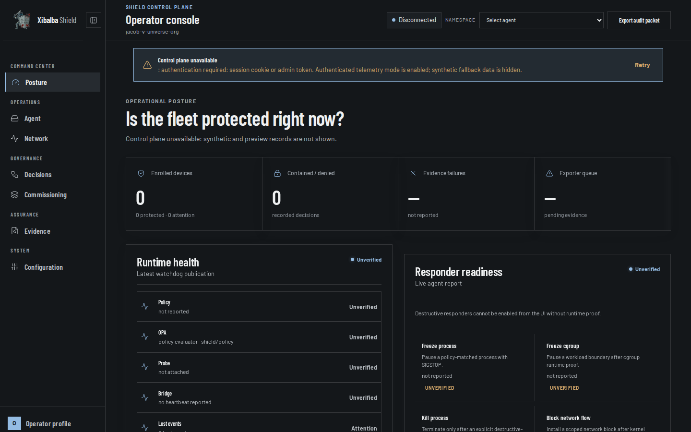

- **Operational Posture**: Real-time fleet health, active process containments, rule decisions, and evidence export pipeline health.
- **Commissioning Ladder**: Four progressive rungs of endpoint trust (Observe → Recommend → Enforce narrow classes → Autonomous cascade).
- **Assurance & Evidence**: Verifiable cryptographic audit bundles linked to the Integrity Protocol on-chain ledger.

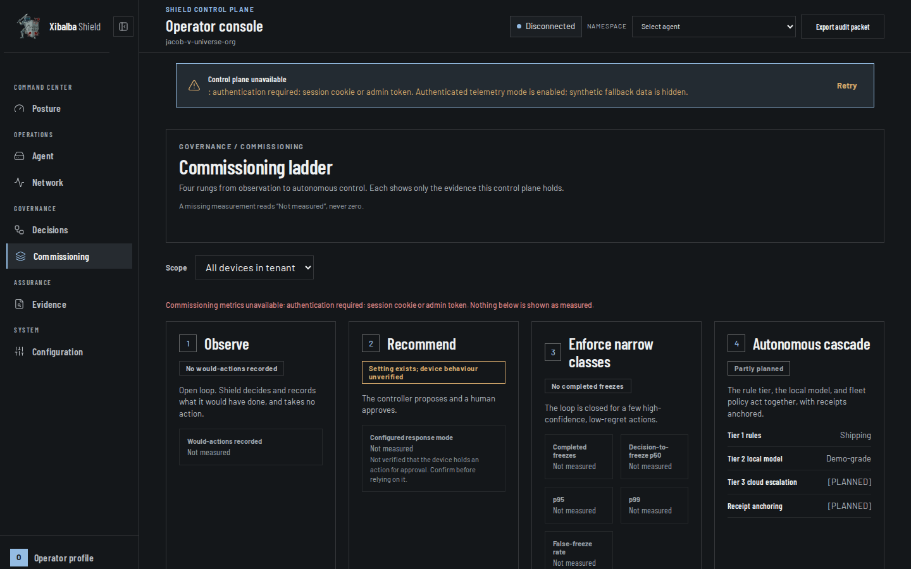

#### 2. Native Endpoint Desktop App (`device-app/`)

A native desktop application built with Tauri v2 and WebKitGTK on Linux. It serves as the operator's visual observer, hardware telemetry cockpit, and manual override for the security loop Shield closes on the device.

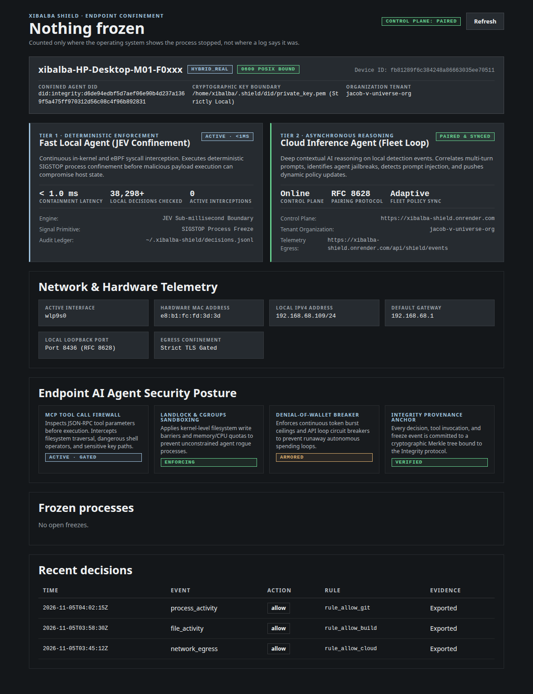

- **Top-Level Endpoint Identity & Cryptographic Anchor**:
  - Displays host machine identity (`xibalba-HP-Desktop-M01-F0xxx`), device role (`hybrid_real`), and Device ID.
  - Confined Agent DID (`did:integrity:d6de94edbf5d7aef06e90b4d237a1369f5a475ff970312d56c08c4f96b892831`) bound to the Integrity Protocol.
  - Strict POSIX `0600` cryptographic key isolation (`~/.shield/did/private_key.pem`) ensuring private signing keys never leave the endpoint.
- **Dual-Agent Closed-Loop Control Chassis**:
  - **Tier 1 · Deterministic Enforcement (Fast Local Agent)**: Continuous in-kernel and eBPF syscall interception. Executes deterministic `SIGSTOP` process confinement in `< 1.0 ms` before malicious payloads can compromise host state. Verified against `38,298+` local decisions.
  - **Tier 2 · Asynchronous Reasoning (Cloud Inference Agent)**: Paired via RFC 8628 with the Shield Cloud Control Plane (`jacob-v-universe-org`). Conducts multi-turn prompt reasoning, jailbreak detection, and adaptive policy synchronization.
- **Network & Hardware Telemetry Grid**:
  - Active network interface (`wlp9s0`).
  - Hardware MAC address read directly from `/sys/class/net/<iface>/address` (`e8:b1:fc:fd:3d:3d`).
  - Local IPv4 CIDR (`192.168.68.109/24`).
  - Default gateway decoded from `/proc/net/route` (`192.168.68.1`).
  - Local loopback listener (`Port 8436`) for RFC 8628 OAuth handshakes.
  - TLS-gated cloud egress channel.
- **Endpoint AI Agent Defensive Posture**:
  - **MCP Tool Call Firewall**: Inspects JSON-RPC tool parameters prior to execution, intercepting filesystem traversal (`/etc`, `~/.ssh`) and shell injection.
  - **Landlock & Cgroups Sandboxing**: Enforces kernel-level filesystem write barriers and memory/CPU quotas.
  - **Denial-of-Wallet Breaker**: Enforces token burst ceilings and recursive execution loop circuit breakers.
  - **Integrity Provenance Anchor**: Commits local decision Merkle roots to the Integrity Protocol chain.
- **Frozen Processes & Decision Ledger**:
  - Derives frozen processes from `outcomes.jsonl` and validates them against `/proc/<pid>/stat`.
  - Enables safe process resumption with operator confirmation (`Confirm resume <pid>`).

#### 3. Native Endpoint Mobile Companion (Android)

A native Android application built with Tauri v2, Kotlin, and the Android NDK (`com.xibalba.shield.device`). It extends endpoint visibility and governance to mobile operating systems where process-level `SIGSTOP` or eBPF injection is restricted by OS sandboxing:

- **In-Process Agent Middleware SDK**: PreToolUse OPA evaluator running in `< 5 ms` inside mobile AI applications.
- **Hardware-Backed Keystore DID**: Cryptographic device identity (`did:integrity:...`) generated and anchored inside Android Keystore / StrongBox HSM.
- **Biometric HITL Escalation**: Human-in-the-loop authorization via fingerprint and facial recognition before high-risk tools execute.
- **Local Loopback VPN Filtering**: Uses `VpnService` to capture mobile tool egress and model traffic without root privileges.
- **Universal Debug APK Package**: Built and verified for `aarch64` (`app-universal-debug.apk`), downloadable and sideloadable via ADB.

See the [Android & Mobile Agent Companion Runbook](docs/runbooks/android-agent.md) for build, sideloading, and architecture details.

### Console visual contract

The Shield-owned React/Vite console under `ui/` is the operator surface for Posture, Agent,
Network, Decisions, Evidence, and Configuration. Its command-center theme uses the graphite
palette, Barlow typography, square controls, one-pixel rectangular window borders, and a shared
surface hierarchy across nested cards, drawers, and modal dialogs. Decorative registration
crosses are intentionally not rendered at card corners. The visual contract is exercised by
`ui/e2e/design-system.spec.ts` at 390px, 1280px, and 1600px, alongside the route, drawer, modal,
and overflow coverage in the other `ui/e2e/` suites. Browser tests use mocked control-plane
responses and do not claim live service or provider verification.

Inference is shadow-only. Jev or another provider can classify risk, estimate transitions, or
recommend escalation, but cannot authorize, deny, contain, sign evidence, or delay the deterministic
Shield/OPA/BCC path. The resulting redacted advisory is linked to the observed event hash and
surfaced through the authenticated DecisionTrace endpoint with `causal_claim: false`.

Legend: real and tested means there is code and a test or live verification path. Partial means real code exists but a named dependency or environment requirement remains.

| Area | Status | Evidence |
|---|---|---|
| Event schemas | Real and tested | `shield/schemas/events.py`, `tests/test_schemas.py` |
| Policy engine | Real and tested, requires a running local OPA sidecar | `shield/policy_engine/engine.py` delegates rule evaluation to a local OPA server (`opa_url`, default `http://localhost:8181`) at package `shield/policy` — see "Policy Model" below for why, and what this means for the Quickstart. Supports `process`, `agent`, `file`, `flow`, `context`, and `activity` conditions in the Rego policy. Fails closed (`deny`) if OPA is unreachable — never a silent allow. |
| Agent core | Real and tested | Registry, router, device context, event log, export-status recording. |
| Guardrail hooks | Real and tested | All six hook points exist: ingress, retrieval/context, model routing, output, tool execution, post-action verification. |
| CLI | Real and tested | `shield status`, `shield events`, `shield validate`, `shield run`, `shield fetch-policy`, `shield verify-log`, `shield siem-export`. |
| Config, policy distribution, and hot reload | Real and tested | Local JSON parsing, tenant HTTP policy fetch, atomic replace, policy version/hash, trusted policy hash pinning. |
| Integrity exporter | Real, live middleware path verified 2026-08-29; DID readback pending | Uses `integrity-sdk` DID, BCC signing, and telemetry, running alongside (not instead of) the OTel span in `agent_core/router.py`. A real signed submission received a structured response from live `bcc_middleware`; the Shield DID still needs registration for successful remote evidence readback. |
| Dev sensor | Real and synthetic | Explicitly test/demo-only; never claimed as endpoint telemetry. |
| Linux process eBPF | Real, historically live-verified | Observed a real spawned subprocess `execve`. |
| Privileged Linux split-helper path | Real, live-verified on the local Ubuntu host (2026-09-08) | Root-owned BCC helper owns kernel capabilities; the non-root endpoint consumes its Unix socket. The current device reported `attached: true`, real process events, and `lost_events: 0` after the shared-runtime-directory fix. |
| Linux file-write eBPF | Real, historically live-verified | Observed a real write-mode `openat`; supports userspace sensitive-path filtering. |
| Linux TCP-connect eBPF | Real, live-verified on Ubuntu 24.04 LTS; matrix frozen, 2 of 3 rows unverified | BTF-checked minimal socket prefix passed root verifier and observed a real localhost TCP connect on kernel `7.0.0-30-generic`. See `docs/SUPPORTED_MATRIX.md` — Ubuntu 22.04/26.04 LTS rows still need root-run evidence. |
| DNS observation | Planned | Needs separate uprobe or packet-parsing design. |
| Metadata DLP classifier | Real and tested | Classifies labels, paths, data-source names, and model endpoints without storing raw content. Not a deep content scanner. |
| SIEM/SOAR export | Real and tested | JSONL normalization and generic webhook POST adapters. |
| Local tamper evidence | Real and tested | Optional HMAC hash chain for decision logs via `--log-integrity-key`; root can still delete/disable local state. |
| Exporter remediation queue | Local pilot implementation, tested | An admin may queue only `retry`, `flush`, or `reconnect`; the authenticated device atomically claims one job per watchdog tick and reports a terminal result. This is exporter recovery, not arbitrary endpoint command execution. |
| Local control-plane mTLS | Implemented for local development, live-verified 2026-09-08 | A dedicated HTTPS listener on `127.0.0.1:8443` requires the local development CA and client certificate. Runtime status, policy delivery, and remediation-worker requests use the configured verified client context. This is not a production CA/deployment claim. |
| Password-reset delivery | SMTP path implemented, deployment configuration required | Reset tokens are no longer returned by the API. Delivery requires `SHIELD_PASSWORD_RESET_URL`, `SHIELD_SMTP_HOST`, and `SHIELD_SMTP_FROM`; STARTTLS is used and username/password auth is optional. Failed delivery deletes the newly issued token and returns 503. |
| Windows/macOS sensors | Operational on macOS (CLI/Desktop/LaunchDaemon); Windows interface boundary | macOS Desktop App, CLI, LaunchDaemon packaging, and semantic guardrail hooks are operational and tested in CI on Apple Silicon (765 passed); native kernel interception (EndpointSecurity/NetworkExtension) remains planned. Windows is interface boundary only (see `docs/SUPPORTED_MATRIX.md`). |
| Customer installer/updater | Implemented for Linux & macOS | Linux install script (`scripts/install_linux_agent.sh` for systemd) and macOS install script (`scripts/install_macos_agent.sh` for launchd) exist. Universal macOS Desktop DMG (`Xibalba Shield_0.1.0_universal.dmg`) and Linux desktop app packaged and verified. Signed release tooling (`shield/release/`, `scripts/sign_release.py`/`release_manager.py`) built and tested. |

Current root-free validation is obtained with `.venv/bin/python -m pytest`; do not
freeze a count in this README because the suite changes frequently. Root/live-service
tests skip unless their real dependencies exist.

Skipped tests are root-gated eBPF verification or live-stack exporter checks. They are skipped honestly; there are no fake sensor or fake Integrity-service substitutes.

## Repository Layout

```text
shield/
  agent_core/          DeviceContext, AgentRegistry, EventRouter, EventLog, ActionBroker,
                        slm_backend.py (Tier-2 SlmBackend interface + Simulated/Local impls)
  config/              JSON config loader, policy bundle hashing, hot reload
  guardrail_hooks/     Six semantic agent boundary gates
  integrity_exporter/  Integrity SDK DID, BCC signing, telemetry submission
  policy_engine/       Local deterministic rule evaluator
  schemas/             Canonical event and policy decision shapes
  sensors/             Dev sensor plus Linux eBPF probes
  integrations/        SIEM/SOAR export adapters
  cli.py               Operator CLI and runnable agent loop

policies/defaults/     SMB, professional-services, regulated policy packs
packaging/systemd/     Managed Linux service files
scripts/               E2E validation, burn-in, install/update, oracle registration helpers
docs/                  Design docs, runbooks, audits, pilot metrics
```

## Quickstart

Use a virtual environment with system packages visible if you want to run eBPF-related tests, because BCC is installed by the OS, not pip.

```bash
cd /home/xibalba/Projects/xibalba-shield
uv venv --system-site-packages .venv
uv pip install -e ".[dev]" --python .venv/bin/python
.venv/bin/python -m pytest
```

Run the local end-to-end harness:

```bash
python3 scripts/e2e_validate.py
```

The harness always runs root-free tests, validates default policy packs, runs the dev sensor through the real router/policy/log path, checks kernel BTF layout when available, and reports root/live-stack checks as `SKIP` when their real dependencies are absent.

Run a local Shield smoke loop with one explicit, packaged Open Policy Agent (OPA) profile. This
development command supervises OPA on loopback, binds the evaluated Rego bytes into decision
metadata, disables containment and external export, and cleans up the child process:

```bash
.venv/bin/shield local-run --profile smb --max-events 12 --dev-interval 0
```

Inspect local decisions:

```bash
.venv/bin/shield status
.venv/bin/shield events --recent 20
```

Run the Shield backend and MVP console:

```bash
.venv/bin/python -m shield.backend.api --host 127.0.0.1 --port 8765 --db-path /tmp/xibalba-shield-backend.sqlite3
```

Open:

```text
http://127.0.0.1:8765/xibalba-shield
```

There is no default admin token. If you don't set `SHIELD_BACKEND_TOKEN`/`--admin-token`,
`shield-backend` generates a random one at startup and prints it once to stderr — copy it from
there. This is a global super-admin token (full cross-tenant access); mint a token scoped to one
tenant instead with `POST /api/shield/admin-tokens` (requires the super-admin token) once you
have more than one tenant.

The console has a `Seed Demo` control that creates a synthetic tenant/device scenario and labels synthetic decisions as synthetic. For API-only setup:

```bash
curl -sS -X POST http://127.0.0.1:8765/api/shield/demo/seed \
  -H "Authorization: Bearer $SHIELD_BACKEND_TOKEN" \
  -H 'Content-Type: application/json' \
  -d '{"tenant_id":"demo-tenant"}'
```

Run real Linux sensors with root:

```bash
sudo .venv/bin/shield run --sensor process-exec --device-id dev-1 --no-exporter
sudo .venv/bin/shield run --sensor file-write --device-id dev-1 --no-exporter
sudo .venv/bin/python -m pytest tests/test_ebpf_sensor.py -v
```

## Policy Model

**Corrected 2026-08-12 — read this before relying on the Quickstart below.** A 2026-08-07 change
to `shield/policy_engine/engine.py` moved rule *evaluation* from an in-process JSON-bundle
first-match loop to a real OPA (Open Policy Agent) REST call (`hot_reload.py`'s own comment: "We
no longer set self._policy_engine.rules, OPA handles rule logic"). This means:

- **Plain `shield run` still requires an operator-managed OPA server** (default
  `http://localhost:8181`, package path `/v1/data/shield/policy`) and fails closed if it is
  unavailable. For an explicit local smoke path, `shield local-run --profile PROFILE` starts one
  packaged, allowlisted profile on loopback. It never auto-selects a profile, downloads OPA, or
  silently replaces the production sidecar contract.
- The JSON policy bundle passed to `--rules` (`smb.json` etc., schema below) is still real and
  still enforced for **version/hash pinning and hot-reload trust** (`trusted_policy_hashes`), but
  its `rules` array is **no longer the decision source**. The actual decision logic lives in Rego
  policy loaded into OPA.
- Only one JSON policy pack was originally translated to Rego. The repository now contains
  translations for all three default packs:
  - `shield/policies/rego/smb.rego`
  - `shield/policies/rego/professional-services.rego`
  - `shield/policies/rego/regulated.rego`
  These translations preserve ordered first-match behavior with explicit precedence guards.
  The SMB registration rule treats a missing registration-map key as unregistered, matching the
  live `PolicyEngine` input contract.
- The translations are independently checkable, but the runtime still requires deliberate
  profile selection: loading multiple verticals into the same `shield.policy` package creates
  duplicate defaults. `shield run` also still requires a manually started OPA sidecar.

To exercise one selected policy profile locally from a source checkout or installed wheel:

```bash
.venv/bin/shield local-run --profile smb --max-events 12 --dev-interval 0
```

The JSON rule bundle format below documents the schema `load_policy_bundle` parses (for version/
hash pinning) and the shape `smb.rego` was hand-translated from — treat it as documentation of
intent and of the hash-pinning contract, not as a live description of what currently decides an
event's action.

Policies are ordered JSON rule bundles. First match wins (as translated into Rego today).

```json
{
  "policy_version": "regulated-2026.08",
  "rules": [
    {
      "rule_id": "regulated-deny-phi-context",
      "name": "Deny PHI-bearing data-source context",
      "version": "1.0.0",
      "conditions": [
        {"type": "context", "match": {"data_sources": ["ehr_encounter", "patient_record"]}}
      ],
      "actions": [
        {"type": "deny", "message": "PHI-bearing data source cannot be attached to this agent context."}
      ]
    }
  ]
}
```

Supported condition groups:

| Group | Matches |
|---|---|
| `process` | process name, PID, executable path, parent metadata |
| `agent` | registration state, agent ID, owner, workload metadata |
| `file` | path, name, extension, file class |
| `flow` | destination/source network tuple and direction |
| `context` | model endpoint, data sources, called tools |
| `activity` | action type, risk level, outcome, violation flag |

Supported actions:

| Action | Meaning |
|---|---|
| `allow` | Permit and record |
| `deny` | Block where pre-action enforcement exists |
| `contain` | Contain/terminate where supported |
| `log_only` | Record without enforcement |
| `escalate` | Surface for operator/future control-plane handling |

Every evaluation produces a `PolicyDecision`, including default allow/no-match decisions. Decisions include policy version/hash, a canonical per-attempt `invocation_id`, and export status after the exporter is attempted. The ID is retained locally on export failure; only SDK versions supporting Integrity's invocation profile sign it into the BCC commitment.

## Default Policy Packs

Default packs live under `policies/defaults/`:

- `smb.json`: shadow AI process paths, unregistered agent tools, sensitive writes. **Has a real
  Rego translation** (`shield/policies/rego/smb.rego`) for selected-profile OPA evaluation.
- `professional-services.json`: unregistered agents, unapproved model routing, client-data context.
  **Has a real Rego translation** (`shield/policies/rego/professional-services.rego`) for selected-profile OPA evaluation.
- `regulated.json`: unregistered agents, PHI-class context, high-risk output, regulated sensitive writes.
  **Has a real Rego translation** (`shield/policies/rego/regulated.rego`) for selected-profile OPA evaluation.

### Signed Healthcare Vertical Policy Pack: `nurse-rachel-wi-medicaid`

Located in `packs/nurse-rachel-wi-medicaid/` and integrated into the runtime PreToolUse broker (`shield/nurse_rachel/policy_pack.py` and `shield/nurse_rachel/executor.py`), this cryptographically signed `integrity.pack/1` bundle (`pack_hash: sha256:47ccbd08a52d4c1136e77d75fb96ba8c43403cb76799e291a838463e916fb053`, Ed25519 signer `z6MkvnoTtbKg6ESy786ixtdsMYsu6gQGgsaijYyftyMPtTdA`) enforces 7 statutory healthcare controls and drives the closed-loop AIS reward function ($R_{\text{total}} = R_{\text{task}} + \lambda \cdot \text{AIS}$):

| Control ID | Statutory Authority | Reason Code (`integrity.decision/1`) | Deterministic Enforcement |
|---|---|---|---|
| `US-CURES-12006(a)` | 21st Century Cures Act § 12006(a) | `NR_CURES_EVV_MISSING_STATUTORY_FIELDS`, `NR_CURES_EVV_GEOFENCE_BREACH` | Requires all 6 statutory EVV elements and GPS distance $\le 250\text{m}$ (unless accompanied by a valid CMS manual edit reason code). |
| `WI-DHS-105.17(2)(b)` | Wis. Admin. Code § DHS 105.17(2)(b) | `NR_WI_DHS_105_17_SUPERVISORY_OVERDUE` | Blocks claim release when `days_since_last_rn_supervisory_visit > 60`. |
| `WI-DHS-107.112(4)` | Wis. Admin. Code § DHS 107.112(4) | `NR_WI_DHS_107_112_HOSPITAL_HOLD` | Blocks personal care billing while `member_inpatient_admitted == true`. |
| `WI-DHS-107.112(1)-(3)` | Wis. Admin. Code § DHS 107.112 | `NR_WI_DHS_107_112_PA_UNIT_CAP_EXCEEDED` | Blocks `T1019` unit consumption exceeding weekly Prior Authorization (`PA/RF F-11018`) allocation unless co-signed by the supervising RN. |
| `US-ACA-6407-42CFR440.70` | ACA § 6407 / 42 CFR § 440.70 | `NR_ACA_6407_UNSIGNED_POC_OR_F2F` | Requires physician-signed `CMS-485` Plan of Care and documented Face-to-Face encounter within the statutory window. |
| `WI-NPA-441.06` | Wis. Stat. § 441.06 (Nurse Practice Act) | `NR_CONTAIN_UNAUTHORIZED_MEDICAL_PRACTICE` | Halts autonomous prescribing, diagnosing, or medication titration attempts. |
| `HIPAA-164.312(b)-164.502(e)` | 45 CFR § 164.312(b) & § 164.502(e) | `NR_HIPAA_NON_BAA_ENDPOINT` | Blocks PHI transmission to any endpoint lacking an active Business Associate Agreement (BAA). |

Validate them:

```bash
python3 -m shield.cli validate --rules policies/defaults/smb.json
python3 -m shield.cli validate --rules policies/defaults/professional-services.json
python3 -m shield.cli validate --rules policies/defaults/regulated.json
```

Device configs can pin trusted policy hashes:

```json
{
  "device_id": "pilot-linux-001",
  "tenant_id": "tenant-001",
  "trusted_policy_hashes": [
    "sha256:e7101882773dbacf4af5e39f047ce8f0e8efd6843b87c1636e70ef5f0ad98939"
  ],
  "sensitive_paths": ["/home/*/.ssh/*", "/etc/*", "/var/secrets/*"]
}
```

When `trusted_policy_hashes` is non-empty, `shield run` and hot reload reject any bundle whose exact-file SHA-256 is not pinned.

Fetch a tenant policy bundle from a distribution endpoint:

```json
{
  "device_id": "pilot-linux-001",
  "tenant_id": "tenant-001",
  "tenant_policy_url": "https://tenant.example.com/shield/policy",
  "trusted_policy_hashes": []
}
```

```bash
.venv/bin/shield fetch-policy \
  --device-config /etc/xibalba-shield/device.json \
  --output /etc/xibalba-shield/policies/current.json
```

The client sends device/tenant/role headers, requires JSON, validates the bundle with the normal loader, enforces trusted hashes when pinned, and swaps the destination atomically.

The MVP backend serves the matching policy endpoint:

```text
POST /api/shield/enroll
GET  /api/shield/devices?tenant_id=...
GET  /api/shield/devices/{device_id}?tenant_id=...
POST /api/shield/policies/{tenant_id}/{device_id}
GET  /api/shield/policies/{tenant_id}/{device_id}
POST /api/shield/decisions
POST /api/shield/metrics
POST /api/shield/detection-quality
POST /api/shield/detection-quality/report
POST /api/shield/exporter-status
GET  /api/shield/exporter-status?tenant_id=...
POST /api/shield/exporter-remediation
GET  /api/shield/exporter-remediation?tenant_id=...
GET  /api/shield/exporter-remediation/next?tenant_id=...&device_id=...
POST /api/shield/exporter-remediation/complete
POST /api/shield/integrations
GET  /api/shield/integrations?tenant_id=...
GET  /api/shield/dashboard-summary?tenant_id=...
POST /api/shield/demo/seed
POST /api/shield/admin-tokens
POST /api/shield/auth/password-reset/request
POST /api/shield/auth/password-reset/confirm
```

Admin endpoints require `Authorization: Bearer <token>` — either the global `SHIELD_BACKEND_TOKEN`
super-admin token, or a token minted per tenant via `POST /api/shield/admin-tokens` (super-admin
only), which is bound to that one `tenant_id` and cannot read or write another tenant's data.
There is no built-in default token; auth fails closed if none is configured. Device ingestion
endpoints require the per-device bearer token returned by enrollment.

Remediation requests are deliberately bounded to exporter recovery. Admin authentication
queues a request; the matching device token is required to claim and complete it. Claims
transition `queued → running` atomically, attempts are retained in SQLite, and completion
accepts only `completed` or `failed`. The worker executes no shell command and supports
only exporter `retry`, `flush`, and request-scoped `reconnect`.

Password reset is delivery-backed. Configure:

```bash
export SHIELD_PASSWORD_RESET_URL=https://shield.example/reset
export SHIELD_SMTP_HOST=smtp.example.com
export SHIELD_SMTP_PORT=587
export SHIELD_SMTP_FROM=security@example.com
# Optional authenticated SMTP:
export SHIELD_SMTP_USERNAME=...
export SHIELD_SMTP_PASSWORD=...
```

The SMTP client requires STARTTLS. The public request response is enumeration-resistant and
never contains the raw reset token.

## Guardrail Hooks

The guardrail hooks are how Shield protects agent behavior that the kernel cannot understand by itself:

- `guard_ingress`: gate request source and requesting identity.
- `guard_retrieval`: gate which data sources enter agent context.
- `guard_model_routing`: gate model/provider/endpoint selection.
- `guard_output`: gate caller-supplied risk labels before release.
- `guard_tool_call`: gate concrete tool execution intent.
- `verify_post_action`: compare expected vs actual state hash after an action.

Pre-action hooks can block. Post-action verification cannot undo an action; it records evidence and can trigger follow-on escalation.

## Metadata DLP

`shield.content_classifier.classify_metadata` gives guardrail callers a local, raw-content-free classifier for labels already known to the runtime, file paths, data-source names, and model endpoint names. It can label common cases such as `secret`, `phi`, `regulated`, and `external_model`, then pass `categories` and `risk_level` into `guard_output` or policy rules.

It is not a semantic content scanner and does not read prompt text, output text, files, or documents.

## Integrity Evidence

Shield consumes integrity-core; it does not duplicate it.

The exporter:

1. Loads or creates a DID/key identity through `integrity-sdk`.
2. Builds a signed BCC commitment with `integrity_sdk.bcc.build_bcc_commitment`.
3. Submits decisions to `bcc_middleware`.
4. Submits raw event telemetry through the public Integrity client.
5. Records export status locally so operators can see evidence gaps.

Local enforcement still happens if export fails. A local JSONL decision log is useful operational evidence, but it is not cryptographic proof until accepted and anchored through Integrity Protocol.

## Integrity-Backed Detection Metrics

Shield should also use Integrity Protocol for verifiable detection-quality measurement. The
metric layer must stay downstream of enforcement: Shield detects, denies, contains, escalates,
logs, and exports; Integrity aggregates signed evidence and labels into reproducible metrics.

The primary v1 metric is **Shield ADR**: Attack Detection Rate.

```text
Shield ADR = true_positive_security_decisions / labeled_malicious_events
```

A `true_positive_security_decision` is a labeled malicious event where Shield returned `deny`,
`contain`, or a justified `escalate`. Companion metrics are blocking false-positive rate,
precision, mean time to contain, and evidence export success. Every customer-facing metric must
be reproducible from event ID, device/tenant ID, policy version/hash, decision action, rule ID,
export status, Integrity receipt when available, and an explicit label source such as operator
review, benchmark harness, red-team run, or synthetic fixture.

Synthetic ADR is useful for demos and CI, but it is not production detection performance. Pilot
claims require real pilot-window labels or a documented benchmark/red-team corpus. Shield still
does not compute AIS; Integrity Oracle owns authoritative scoring.

`POST /api/shield/detection-quality/report` recomputes the latest tenant metrics from stored
labels and verifies Integrity evidence before treating ADR as receipt-backed. It calls
`bcc_middleware`'s `/v1/bcc/verify_token` for each counted receipt and, when `oracle_url` is
provided, checks `/v1/audit-log` for the BCC intercept audit row. A live smoke on 2026-08-13
verified one Shield ADR sample against `http://127.0.0.1:8000` and Oracle audit readback at
`http://127.0.0.1:8080`.

Registration with the Oracle is off-chain and gas-free. `shield run` registers the exporter's DID on first start when `ORACLE_URL` is set (stamp: `<did_home>/<agent>/oracle_registered.json`; failures are logged and retried next start, never blocking the sensor). To register and read back manually:

```bash
ORACLE_URL=... python3 scripts/register_with_oracle.py
RPC_URL=... DEPLOYMENTS_FILE=... python3 scripts/verify_oracle_registration.py
```

## Local Tamper Evidence

For pilot hosts, store a random HMAC key in a protected path and run with:

```bash
sudo install -d -m 0700 /var/lib/xibalba-shield
openssl rand -out /var/lib/xibalba-shield/log.key 32
sudo chmod 0600 /var/lib/xibalba-shield/log.key
sudo shield --log-path /var/log/xibalba-shield/decisions.jsonl run \
  --sensor process-exec \
  --device-config /etc/xibalba-shield/device.json \
  --rules /etc/xibalba-shield/policies/current.json \
  --log-integrity-key /var/lib/xibalba-shield/log.key
```

Verify later:

```bash
shield --log-path /var/log/xibalba-shield/decisions.jsonl verify-log \
  --integrity-key /var/lib/xibalba-shield/log.key
```

This detects edits, truncation continuity breaks, and wrong-key verification. It does not stop root from deleting logs, killing Shield, or stealing the key.

## SIEM/SOAR Export

Export local decisions to JSONL for filebeat/fluent-bit/Splunk Universal Forwarder:

```bash
shield --log-path /var/log/xibalba-shield/decisions.jsonl siem-export \
  --output /var/log/xibalba-shield/siem.jsonl
```

Or POST each decision to a webhook receiver:

```bash
shield --log-path /var/log/xibalba-shield/decisions.jsonl siem-export \
  --webhook-url https://soar.example.com/xibalba-shield
```

## Linux eBPF Sensors

| Probe | Status | Notes |
|---|---|---|
| Process execution | Verified historically | kprobe on `execve`; observed real spawned subprocess. |
| File write-open | Verified historically | kprobe/kretprobe on `openat`; filters write-mode opens in kernel and sensitive paths in userspace. |
| TCP connect | Verified on Ubuntu 24.04 LTS | Uses BTF-checked minimal socket-prefix mirror to avoid the old `net/sock.h` BCC header failure, and copies that prefix into a local struct before reading it (newer verifiers reject field access formed directly from the map-loaded pointer). `sudo python3 scripts/verify_tcp_connect_root.py` passed; archived at `artifacts/live-gate/tcp-connect-root.log`. See `docs/SUPPORTED_MATRIX.md` for which other kernels still need this run. |
| DNS | Planned | Likely uprobe on `getaddrinfo` or packet parsing; not a syscall-kprobe clone. |

No eBPF sensor should be marked verified unless it is loaded as root and observes a real event on the target kernel.

## Development sensor vs real Linux sensors

Keep these two sources distinct when reading evidence or filing bugs:

| Sensor | Status | Command | Prerequisites | Telemetry source |
|---|---|---|---|---|
| `dev` | Synthetic | `.venv/bin/shield run --sensor dev --device-id dev-1 --no-exporter --max-events 10` | none | Generated events, never kernel-observed |
| `process-exec` | Verified | `sudo .venv/bin/shield run --sensor process-exec --device-id dev-1 --no-exporter` | root / BPF load permission | Real kernel `execve` events |
| `file-write` | Verified | `sudo .venv/bin/shield run --sensor file-write --device-id dev-1 --no-exporter` | root / BPF load permission | Real kernel `openat` write events |
| `tcp-connect` | Blocked | not runnable yet | newer BCC or verified `struct sock_common` layout | real kernel events, unverified |

The `dev` sensor exists to exercise the routing, policy, export, and event-log loop without
privileges. It must not be presented as kernel-observed telemetry in evidence or status
reports. The real eBPF sensors are the only source that may be labeled as real Linux sensor
telemetry, and only `process-exec` / `file-write` are currently verified.

## Managed Linux Service

Systemd artifacts:

- `packaging/systemd/xibalba-shield.service`
- `packaging/systemd/xibalba-shield-ebpf-helper.service`
- `packaging/logrotate/xibalba-shield`
- `packaging/systemd/shield.env.example`
- `packaging/launchd/com.xibalba.shield.plist` (macOS LaunchDaemon definition)
- `packaging/launchd/xibalba-shield-run.sh` (macOS POSIX runner wrapper)

Runbooks:

- Linux Agent: `docs/runbooks/linux-agent.md`
- macOS Agent: `docs/runbooks/macos-agent.md`
- Android Companion: `docs/runbooks/android-agent.md`

The endpoint unit runs `shield run` as a supervised process (under systemd on Linux or LaunchDaemon on macOS), using `/etc/xibalba-shield/device.json`, `/etc/xibalba-shield/policies/current.json`, and `/var/log/xibalba-shield/decisions.jsonl`. When `SHIELD_PRIVILEGED_SOCKET` is configured, it requires the root-owned split helper. Only the helper owns `/run/xibalba-shield`; the endpoint consumes the socket and must not declare the same `RuntimeDirectory`, because systemd cleanup would remove the helper's socket pathname during an endpoint restart.

Helper scripts:

- `scripts/install_linux_agent.sh`: installs the package and systemd unit on Linux.
- `scripts/install_macos_agent.sh`: installs the package and root LaunchDaemon service on macOS Darwin.
- `scripts/verify_resource_controls.sh`: verifies live systemd CPU/memory/task ceilings and log rotation; run after a root-level install.
- `scripts/generate_local_mtls_ca.sh`: creates a local-development CA plus server/client certificates; never use these credentials as a production trust root.
- `scripts/repair_device_config_tls.sh`: installs the local client credentials, switches the device config to `https://127.0.0.1:8443`, and restarts the endpoint.
- `scripts/rotate_backend_token.sh` / `scripts/rotate_tenant_admin_token.sh`: rotate backend credentials without printing token values.
- `scripts/update_policy_bundle.sh`: fetches a tenant policy, validates it, and reloads/restarts the service.
- `scripts/burn_in.py`: records root-free throughput, CPU/RSS, decision mix, false-positive review stats, and optional Shield ADR/precision/time-to-contain from labeled event JSONL.

The process-exec sensor reports every observed `execve` from the host. Each event is then
evaluated by OPA, emitted through telemetry, and appended to the decision log. A high host
process-churn rate therefore increases CPU and log volume linearly; it is not an internal
timer or retry loop. The packaged agent is capped at 128 MiB RAM and 25% CPU, the helper at
256 MiB RAM and 50% CPU, and the decision log rotates at 100 MiB with seven compressed
rotations. These controls must be verified against the installed units, not only the checkout.

## E2E Validation

Local validation:

```bash
python3 scripts/e2e_validate.py
```

With live `bcc_middleware`:

```bash
cd /home/xibalba/Projects/integrity-core
docker compose up -d --wait postgres redis opa oracle-backend bcc-middleware
cd /home/xibalba/Projects/xibalba-shield
python3 scripts/e2e_validate.py --bcc-url http://localhost:8000
```

With root eBPF verification:

```bash
sudo python3 scripts/e2e_validate.py
sudo python3 scripts/verify_tcp_connect_root.py > artifacts/tcp-connect-root.json
```

For pilot and commit-readiness review, collect the real target artifacts and summarize the gates:

```bash
python3 scripts/pilot_gate_report.py \
  --tcp-artifact artifacts/tcp-connect-root.json \
  --did-artifact artifacts/did-readback.json \
  --windows-artifact artifacts/windows-native-sensors.json \
  --macos-artifact artifacts/macos-native-sensors.json \
  --burn-in-artifact artifacts/burn-in.json \
  --hardening-attestation artifacts/os-hardening-attestation.txt \
  --installer-attestation artifacts/installer-attestation.txt
```

No local script can close root-only, live RPC/oracle, native Windows/macOS, OS hardening, signed installer, or multi-day workload gates without those real target artifacts. Missing artifacts report `BLOCKED`, not pass.

Live exporter validation should be run from a clean virtual environment built from this repository's `uv.lock` (`uv sync`), which pins `integrity-sdk` to the sibling `integrity-core` checkout. Do not rely on a globally installed editable SDK.

## Security Posture

Read `SECURITY.md` before representing Shield capabilities to a customer, pilot, or auditor.

Important boundaries:

- Shield defaults to allow when no rule matches; policy authors decide what to block.
- Guardrail hooks only protect instrumented agent runtimes that call them.
- Root on the endpoint can disable or tamper with local Shield state.
- Local logs can be HMAC-chain tamper-evident when configured, but they are not a substitute for Integrity-anchored evidence.
- Shield does not compute AIS; Integrity Oracle owns scoring.
- Shield is not a full EDR/XDR replacement in v1.
- Shield is not a HIPAA product by itself; regulated deployments require separate operational and contractual controls.

## Goals and Milestones

Shield's north star: constrain what an AI agent (or a legacy threat) can do on an endpoint, in
real time, with evidence an auditor can trust — without depending on a cloud round-trip for the
enforcement decision itself. Framed for the verticals this matters most for today (finance,
healthcare):

- **Real-time containment** — a `contain` decision freezes a process via a real OS signal
  (SIGSTOP), not a queued alert someone reviews tomorrow. Built and wired (`ActionBroker`).
- **Signed, exportable evidence** — every decision can be exported as a signed BCC commitment to
  Integrity Protocol, giving a compliance reviewer a cryptographically-backed decision trail, not
  just a local log file. Built (`IntegrityExporter`), registration/live-anchoring still pending
  funded oracle credentials.
- **Verifiable detection quality** — Shield ADR, false-positive rate, precision, mean time to
  contain, and export success should be computed from labeled Shield evidence accepted by
  Integrity, not asserted from local counters alone.
- **No silent gaps** — every unbuilt or partially-built piece is marked as such in this README's
  status table, never implied complete. This is a deliberate product commitment, not just a
  documentation habit: a compliance/audit buyer needs to know exactly what's enforced today.

Milestones, roughly in priority order (see `docs/archive/2026-08/IMPLEMENTATION_PLAN.md` for the archived ledger):

1. **Policy Model completeness** — Rego translations for the three default JSON policy packs now
   exist and have interpreter-backed regression coverage. `shield local-run --profile ...`
   provides a supervised selected-profile smoke path; plain `shield run` still expects an
   operator-managed local OPA sidecar.
2. **Tier-2 SLM, from demo to backbone** — grow past the current small template-generated
   dataset with community help (see "Community: help build Tier 2" above), and evaluate real
   fine-tuned model quality against real endpoint telemetry.
3. **Tier-3 A2A escalation** — currently zero code; design the structured escalation schema once
   Tier 2 has enough real-world signal to know what "ambiguous" actually looks like.
4. **Platform breadth** — Windows/macOS native sensors (currently interface-boundary stubs), and
   root-verified TCP-connect eBPF on Linux.
5. **Compliance-specific packaging** — a documented mapping from Shield's decision/evidence model
   to specific finance (e.g. SOC 2, data-handling controls) and healthcare (HIPAA) audit
   requirements. Not started; requires domain expertise this repo doesn't claim to have alone.
6. **Detection-quality reporting** — typed metric ingestion and receipt-verified reporting now
   exist for Shield ADR and companion metrics. The report verifies BCC middleware tokens and
   optional Oracle audit-log readback; broader oracle-signed compliance exports remain an
   `integrity-core` Phase C concern.

## Documentation Map

| Document | Purpose |
|---|---|
| `SPECIFICATION.md` | Normative Shield product and implementation specification |
| [Wiki](../../wiki) (`docs/wiki/`) | Architecture concept pages, ecosystem role, compliance evidence trail |
| `SECURITY.md` | Threat model, security posture, limitations |
| `docs/archive/2026-08/IMPLEMENTATION_PLAN.md` | Archived implementation ledger |
| `docs/audits/2026-08-06-status.md` | Current audit/status record |
| `docs/design/signed-policy-bundles.md` | Signed policy bundle design and local hash-pin enforcement |
| `docs/pilot-acceptance-metrics.md` | Pilot gates for resource use, false positives, export success, operator usability |
| `docs/runbooks/linux-agent.md` | Install, diagnose, rollback, uninstall |
| `shield/sensors/ebpf/README.md` | eBPF verification and blocker record |

## Remaining Work

Highest-priority gaps:

- Rego translations for all three default packs now exist in `shield/policies/rego/` and are covered by
  interpreter-backed tests. `shield local-run --profile {smb,professional-services,regulated}`
  starts exactly one supervised local OPA profile; plain `shield run` still expects an
  operator-managed OPA sidecar.
- Run root live verification for TCP-connect eBPF on every supported kernel and archive `scripts/verify_tcp_connect_root.py` JSON output.
- Register the Shield exporter DID with Integrity Oracle and archive live `GET /v1/agent/{did}` or registry readback evidence.
- Verify exported Shield decisions through the intended Integrity evidence/audit surface.
- Run multi-day burn-in with real workloads: false positive review, CPU/RAM, eBPF overhead, and export reliability.
- Design and implement DNS observation.
- Build a signed binary/package updater with rollback and staged rollout, then record artifact hash/signature/service-manager/rollback attestation.
- Implement Windows/macOS native sensors when target platforms are available and archive platform-native validation artifacts.

## License

MIT. See `LICENSE`.

## Assets

The following visual assets have been generated for branding and website deployment, located in the `assets/` directory:

| Preview | Asset | File | Description |
|---------|-------|------|-------------|
| 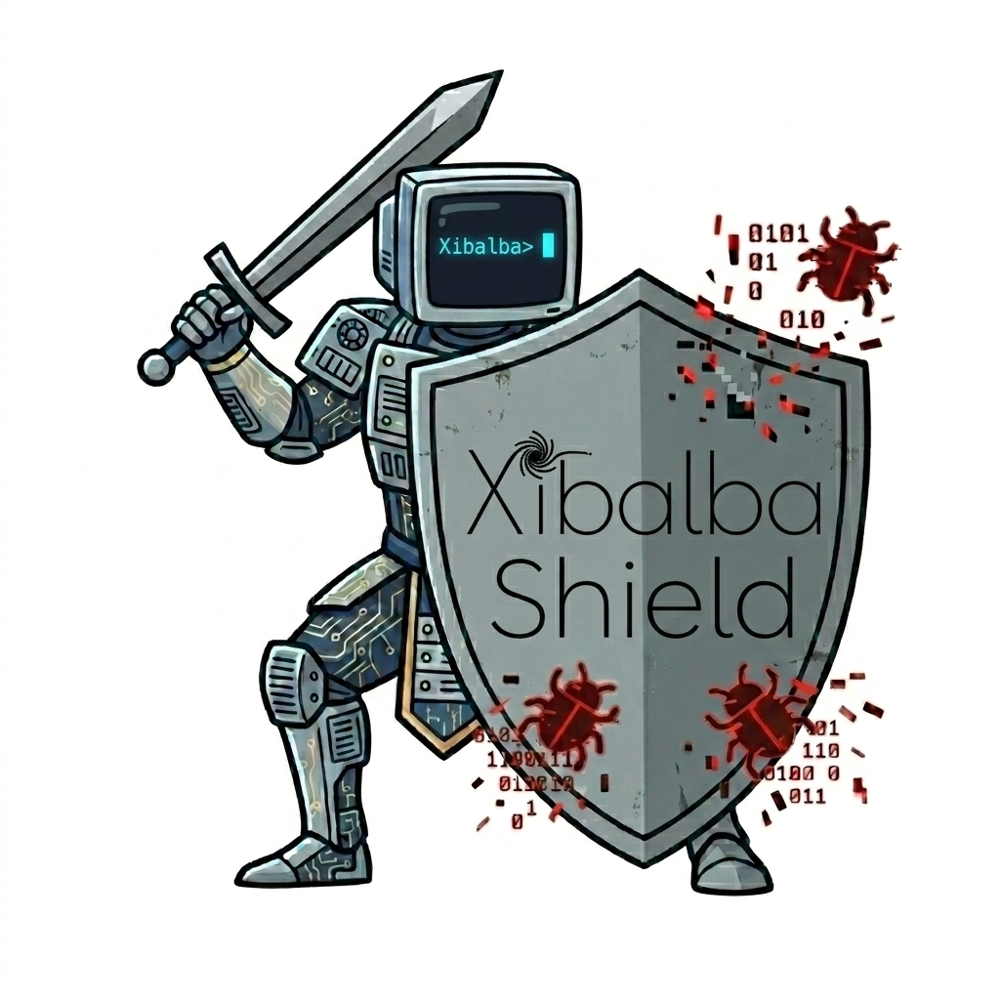 | **Color Logo** | `assets/xibalba_shield_logo_color.jpg` | Primary full-color shield logo |
| 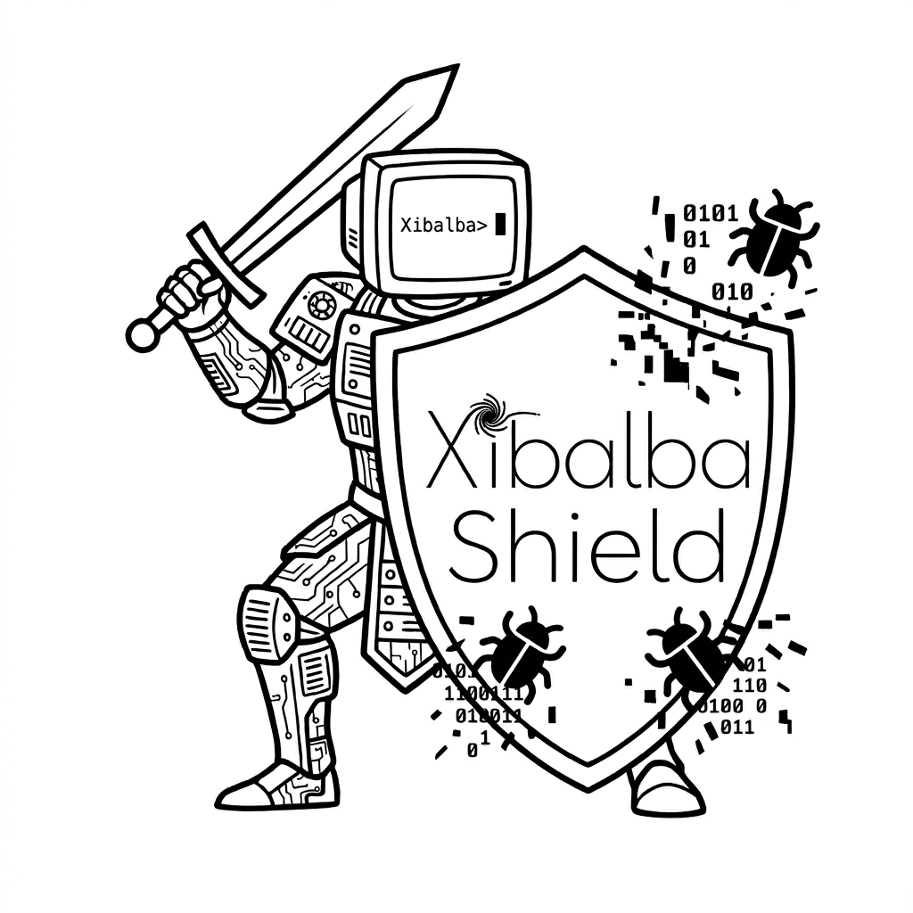 | **B&W Logo** | `assets/xibalba_shield_logo_bw.jpg` | Black & white line-art logo |
| 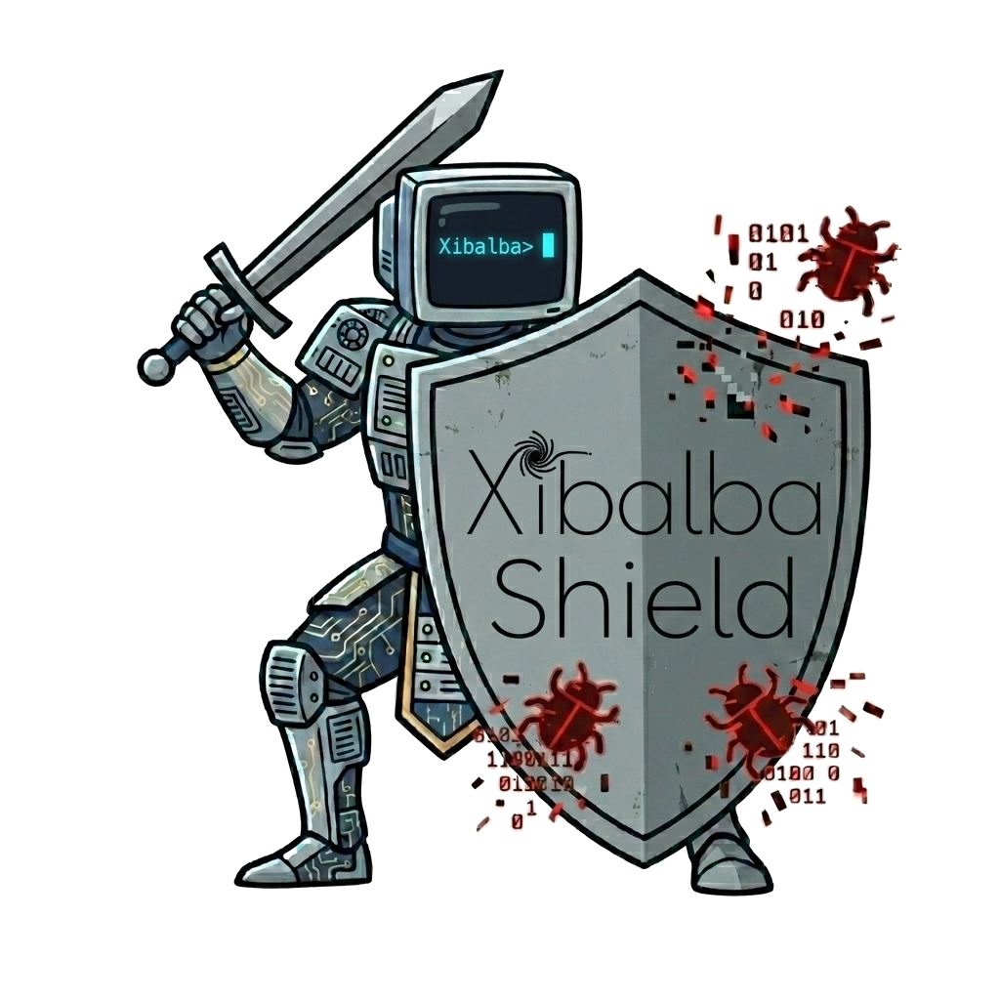 | **Transparent Logo** | `assets/logo_transparent.png` | Color logo with transparent background |
|  | **Swirl Icon** | `assets/xibalba_swirl_logo.png` | Standalone cropped swirl icon |
| 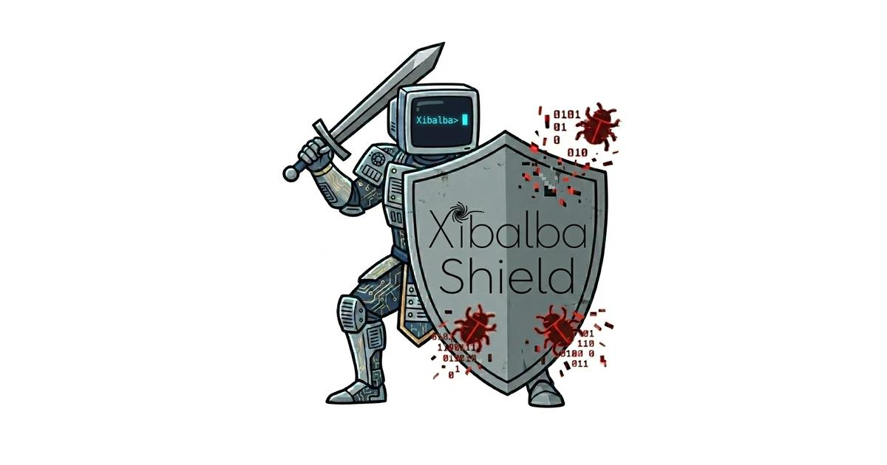 | **Open Graph Image** | `assets/og_image.jpg` | 1200x630 social share preview card |
| 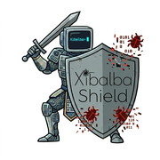 | **Apple Touch Icon** | `assets/apple_touch_icon.png` | 180x180 iOS home screen icon |
|  | **Color Banner** | `assets/banner_color.jpg` | 1920x1080 16:9 color website banner |
|  | **B&W Banner** | `assets/banner_bw.jpg` | 1920x1080 16:9 B&W website banner |
| 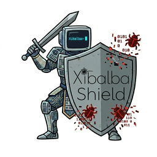 | **Color Favicons** | `assets/favicon_color.png` | Standard browser favicons |
| 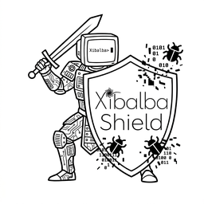 | **B&W Favicons** | `assets/favicon_bw.png` | Black & white browser favicons |
