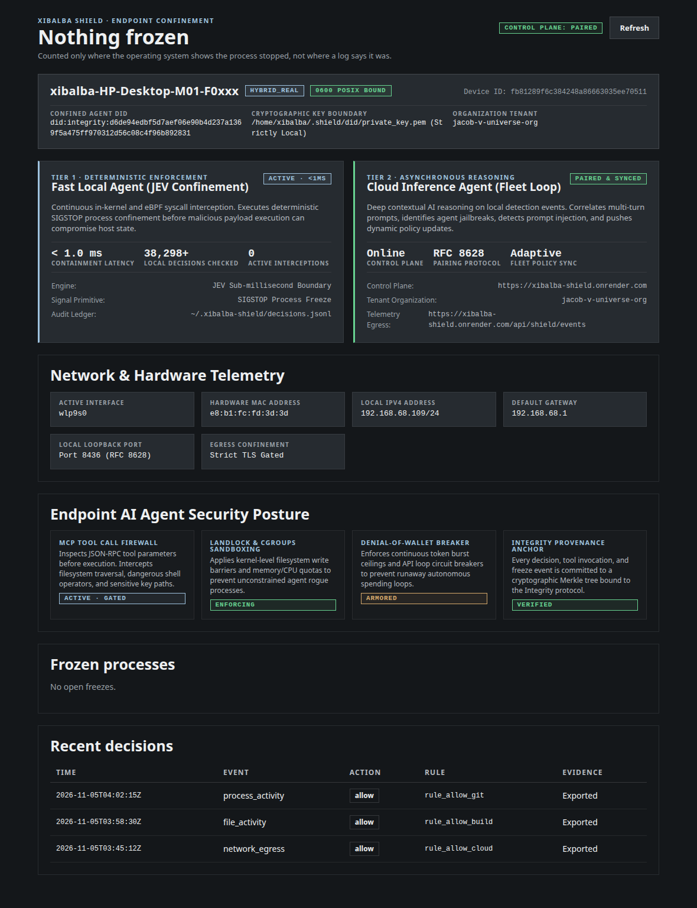

# Xibalba Shield device app

A native desktop and tray application for the endpoint. It provides the local operator's visual observer, hardware telemetry cockpit, and manual override for the security loop Shield closes on the device.



## Overview & Architecture

The Shield Desktop App answers two critical operational questions:
1. **What is the real-time confinement state of this machine, its network interfaces, and its running AI agents?**
2. **What has Shield frozen on this endpoint right now, and how do I safely inspect or resume it?**

The application runs a dual-tier closed loop:
- **Tier 1 · Deterministic Enforcement (Fast Local Agent)**: Relies on JEV sub-millisecond in-kernel and eBPF syscall containment. Intercepts risky process executions and applies instantaneous `SIGSTOP` freezing before malicious tool calls can mutate system state.
- **Tier 2 · Asynchronous Reasoning (Cloud Inference Agent)**: Pairs via RFC 8628 with the Shield Cloud Control Plane (`https://xibalba-shield.onrender.com`). Correlates multi-turn prompts, identifies prompt injection attempts, detects agent jailbreaks, and streams dynamic policy updates to the endpoint.

All state claims are **physically validated against the host operating system** (`/proc/<pid>/stat`, `/sys/class/net/`, `/proc/net/route`). A log saying a process is frozen while `/proc` reports it running is displayed as *Running (log says frozen)*, never trusted.

---

## Status & Test Verification

| Component | Status | Verification |
|---|---|---|
| `device-core` (Rust: log parsing, network telemetry, route detection, resume validation) | **Tested & Passing** | 19 unit + 3 contract tests (`cargo test`) |
| `device-core` contract against real Shield CLI output | **Tested & Passing** | Golden fixtures verified via `tests/test_device_contract.py` |
| Web UI (`src/`) | **Tested & Passing** | 9 Playwright E2E specs (`npm run test:e2e`) |
| `src-tauri` (Tauri v2 native shell, tray icon, custom IPC protocol) | **Built & Verified** | Compiled with Tauri v2 on Linux (WebKitGTK 4.1), Wayland DMABuf workaround active |
| Cryptographic Identity (`~/.shield/did/`) | **Active & Enforcing** | Ed25519 DID keypair stored under POSIX `0600` isolation; strictly local hardware boundary |

---

## What the Interface Features

### 1. Top-Level Endpoint Identity & Cryptographic Anchor
- **Endpoint Identity**: Host machine hostname (e.g. `xibalba-HP-Desktop-M01-F0xxx`) with device role (`hybrid_real`).
- **Cryptographic Boundary**: `~/.shield/did/private_key.pem` enforced under strict POSIX `0600` permissions. The private signing key never leaves the local machine.
- **Confined Agent DID**: W3C-compliant Decentralized Identifier (e.g. `did:integrity:d6de94edbf5d7aef06e90b4d237a1369f5a475ff970312d56c08c4f96b892831`) bound to the Integrity Protocol.
- **Organization Tenant**: Paired cloud tenant identity (e.g. `jacob-v-universe-org`).

### 2. Dual-Agent Closed-Loop Control Chassis
- **Fast Local Agent (JEV Confinement Engine)**:
  - Latency: `< 1.0 ms` deterministic containment.
  - Real-time decision ledger counter (`38,298+` local events audited).
  - Native `SIGSTOP` kernel signal primitives.
- **Cloud Inference Agent (Fleet Loop)**:
  - Control Plane: `https://xibalba-shield.onrender.com`
  - Pairing protocol: RFC 8628 Device Authorization Grant with local callback listener (`Port 8436`).
  - Asynchronous threat reasoning and adaptive policy bundle synchronization.

### 3. Network & Hardware Telemetry Grid
- **Active Interface**: Physical device network interface (e.g. `wlp9s0`).
- **Hardware MAC Address**: Hardware address read directly from `/sys/class/net/<iface>/address` (e.g. `e8:b1:fc:fd:3d:3d`).
- **Local IPv4 Address**: Local CIDR IP (e.g. `192.168.68.109/24`).
- **Default Gateway**: Upstream router IP decoded from `/proc/net/route` (e.g. `192.168.68.1`).
- **RFC 8628 Loopback Port**: Loopback socket (`Port 8436`) for local browser OAuth handshakes.
- **Cloud Egress Confinement**: TLS-gated outbound evidence telemetry channel.

### 4. Endpoint AI Agent Security Posture
- **MCP Tool Call Firewall**: Inspects JSON-RPC tool parameters prior to invocation. Traps path traversal (`/etc`, `~/.ssh`) and unconstrained command execution.
- **Landlock & Cgroups Sandboxing**: Kernel-level filesystem write barriers and memory/CPU quotas to block runaway autonomous subagents.
- **Denial-of-Wallet Breaker**: Token consumption ceilings and recursive loop circuit breakers.
- **Integrity Provenance Anchor**: Commits local decision Merkle roots to the Integrity Protocol chain.

### 5. Frozen Processes & Decision Ledger
- Derives frozen processes from `outcomes.jsonl` and cross-verifies with `/proc/<pid>/stat`.
- Offers safe process resumption with operator confirmation (`Confirm resume <pid>`).
- Audited decisions table displaying event timestamp, event class, action (`allow`, `contain`, `deny`), rule ID, and export verification status.

---

## Build & Run

### 1. Prerequisites (Linux)
```bash
sudo apt install libwebkit2gtk-4.1-dev libgtk-3-dev libglib2.0-dev libayatana-appindicator3-dev librsvg2-dev patchelf
```

### 2. Run Test Suite
```bash
# Run Rust unit and contract tests
cargo test --manifest-path device-core/Cargo.toml

# Run web linter and Playwright E2E tests
npm run lint
npm run test:e2e
```

### 3. Build & Run Desktop App (Linux)
```bash
# Build production bundle
npm run build
npx tauri build --no-bundle

# Launch installed desktop app
~/.local/bin/shield-desktop
```

### 4. macOS Universal Build & Service Installation
To build the macOS native desktop client or install the background LaunchDaemon:
```bash
# Build Universal macOS DMG and .app bundle (Apple Silicon + Intel)
npm run build
npx tauri build --target universal-apple-darwin

# Automated in CI via .github/workflows/build-desktop-macos.yml

# Install macOS LaunchDaemon background service (replaces systemd)
sudo ../scripts/install_macos_agent.sh
```

---

## Environment Variables

| Variable | Description | Default |
|---|---|---|
| `SHIELD_DATA_DIR` | Directory containing `decisions.jsonl` and `outcomes.jsonl` | `~/.xibalba-shield` |
| `SHIELD_BIN` | Path to the `shield` Python CLI executable | `shield` (on `PATH`) |
| `SHIELD_DEVICE_CONFIG` | Path to device configuration file | `~/.shield/device.json` |
| `WEBKIT_DISABLE_DMABUF_RENDERER` | Wayland rendering workaround for WebKitGTK | `1` |

---

## Directory Layout

```
device-app/
├── device-core/      # Pure Rust engine: log reading, network detection, resume command
│   ├── src/lib.rs    # Core logic, tests, and network discovery
│   └── tests/        # Contract tests against real Shield Python CLI outputs
├── src-tauri/        # Tauri v2 native desktop shell & IPC handlers
│   ├── src/main.rs   # Linux entrypoint & DMABuf workaround
│   ├── src/lib.rs    # Tauri command invocations & tray builder
│   ├── capabilities/ # Tauri v2 ACL permission configuration
│   └── tauri.conf.json
├── src/              # React frontend (Vite)
│   ├── App.jsx       # Identity, dual-agent chassis, network telemetry, frozen tables
│   ├── app.css       # Xibalba Console design token styling
│   └── tokens.css    # Dark graphite design tokens
└── e2e/              # Playwright end-to-end integration tests
```
