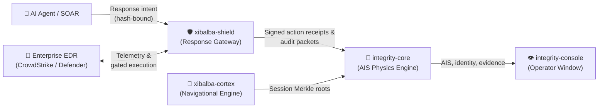

# Ecosystem Role & Four-Repository Topology

## Table of contents

- [Overview](#overview)
- [How Shield Connects](#how-shield-connects)
- [Repository Boundaries](#repository-boundaries)
- [Cloud Deployment](#cloud-deployment)

## Overview

Xibalba Shield is the **Cryptographic Topology & Response Governance Layer** in a four-repository ecosystem architected around a unified physical principle: **logic is geometric graph traversal, and compliance is the native reward function.**

| Repository | Role | Paradigm & Function | Live Deployment |
|---|---|---|---|
| **`xibalba-shield`** (This Repo) | **🛡️ Cryptographic Topology & Response Governance** | Enforces topological boundary gating, zero-probability unauthorized state spaces, and vendor-neutral response governance across enterprise EDRs (CrowdStrike, Defender) and AI agents (MCP, SOAR). *"The EDR detects and acts; Shield proves who authorized it."* Produces tamper-evident audit ledgers and HIPAA assurance packets. | Cloud Console: [`https://xibalba-shield.onrender.com`](https://xibalba-shield.onrender.com) |
| **`integrity-core`** | **🦴 The Physics Engine & AI Agent Control Layer** | Implements the Autonomous Integrity Score (AIS) as the deterministic reinforcement learning reward function ($R_{\text{total}} = R_{\text{task}} + \lambda \cdot \text{AIS}$). Governs on-chain DIDs, Policy Packs, Behavioral Commitment Chains (BCC), Merkle state anchors, and cryptographic state verification. | Oracle: [`https://integrity-oracle.onrender.com`](https://integrity-oracle.onrender.com) |
| **`xibalba-cortex`** | **🧠 The Navigational Engine** | Neuro-symbolic knowledge graph and active inference engine. Replaces probabilistic text generation with geometric graph traversal (R-GCN + TKGE/TransE), dynamic logit masking, temporal event reification, and domain connectors (Biomedical/MIMIC-IV, FHIR live-feeds, ChEMBL, CMS cost friction). | Pilot: [`https://cortex-managed-pilot.onrender.com`](https://cortex-managed-pilot.onrender.com) |
| **`integrity-console`** | **👁️ The Universal Verifiable Operator Window** | Unified operator presentation layer. Visualizes agent graph navigation trajectories, multi-agent DID credentials, AIS score distributions, real-time response approval queues, and cryptographic Merkle verification. | Operator Window: [`https://integrity-console-test.onrender.com`](https://integrity-console-test.onrender.com) |

---

## How Shield Connects

- **Inbound, from Agents:** Autonomous agents submit hash-bound response intents (`contain_host`, `kill_process`, `rtr_command`). Shield evaluates deterministic tenant policy, routing high-impact operations into the **Approval Queue** for human/two-person sign-off.
- **Inbound, from EDRs:** Enterprise EDRs (CrowdStrike Falcon, Microsoft Defender) provide endpoint telemetry and detection signals. Shield normalizes detections and verifies authorization without duplicating EDR consoles.
- **Outbound, to Endpoint Responders:** Only upon atomic consume of a cryptographically valid `ExecutionAuthorization` does Shield dispatch containment/remediation commands via the `EndpointProvider` connector interface.
- **Outbound, to Integrity Protocol:** Every decision, approval, and execution event is appended to a local hash-chained ledger and spooled via `integrity_exporter` for anchoring into `integrity-core`.
- **Outbound, to Integrity Console:** Surfaces real-time approval queues, tamper-evident action ledgers, and auditor-ready compliance bundles.

---

## Repository Boundaries

Shield consumes `integrity-sdk` as a one-way dependency, the same way any third-party agent runtime would — no privileged API, no special-cased access. `integrity-core` has zero dependency back onto this repository in either direction. That boundary is the entire reason the split exists: a kernel-sensor bug in Shield must never be able to affect AIS computation or Merkle conventions in the parent protocol.

---

## Cloud Deployment

Shield is hosted in production on Render:
- **Cloud Console:** [`https://xibalba-shield.onrender.com`](https://xibalba-shield.onrender.com)
- **Health Check:** `/api/shield/health`
- **Device Pairing:** RFC 8628 commissioning flow (`shield pair --backend-url https://xibalba-shield.onrender.com`)
