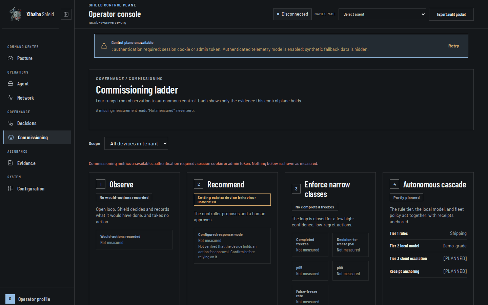

## Table of contents

- [Overview](#overview)
- [Evidence per rung](#evidence-per-rung)
- [Honesty rules](#honesty-rules)
- [Known gaps](#known-gaps)
- [Related pages](#related-pages)

## Overview

The console's **Commissioning** view (Governance group) shows the four-rung ladder from observation
to autonomous control, as a plant is commissioned one rung at a time. Each rung shows only
evidence the control plane holds, read from `GET /api/shield/commissioning-metrics`
(`ShieldStore.commissioning_metrics`).

## Evidence per rung

| Rung | Evidence shown | Source |
|---|---|---|
| 1 Observe | Would-actions recorded in observe mode, by action | `decisions` rows carrying the `observation-only would-action` marker |
| 2 Recommend | The configured response mode, labelled unverified on the device | tenant settings `containmentMode` |
| 3 Enforce narrow classes | Completed freezes, decision-to-freeze p50/p95/p99, false-freeze rate | `enforcement_outcomes` |
| 4 Autonomous cascade | Names Tier 1, Tier 2, Tier 3, receipt anchoring and their status | static, labelled |

**Decision-to-freeze** is `EnforcementOutcome.handle_to_contain_ms`: monotonic milliseconds from
`EventRouter.handle()` entry to `ActionBroker.contain()` returning. It is not sensor-event-to-freeze;
see [Action Broker](action-broker.md). It is distinct from the time-to-contain defined in
[Shield Detection Quality Metrics](shield-detection-quality-metrics.md).

**False-freeze rate** is operator resumes that name a freeze (`shield resume --event-id`), over
completed freezes in the window. Unlinked resumes are reported separately and not counted.

## Honesty rules

- A missing measurement renders as "Not measured", never 0 (`ui/src/commissioningFormat.js`). The
  Playwright spec asserts an empty backend produces no `0 ms` or `0%`.
- The endpoint returns `null` for unmeasured figures and lists `not_instrumented`; the view shows
  that list verbatim.
- The view is part of the design-system route sweep in `ui/e2e/design-system.spec.ts`.

## Known gaps

- Sensor-event-to-freeze latency: event timestamps are whole-second. `[PLANNED]`
- High-risk coverage percentage: the high-risk class list is not stored in the backend. `[PLANNED]`
- Rung 2: no device-side approval workflow is confirmed in code.
- Gate receipts live on the device (`--receipt-dir`) and are not uploaded to the backend, so the
  console cannot display them. `[PLANNED]`
- Refusals by the protected-process interlock are not yet a separate metric; that guard is in a
  separate change.

## Related pages

- [Action Broker](action-broker.md)
- [Shield Detection Quality Metrics](shield-detection-quality-metrics.md)
