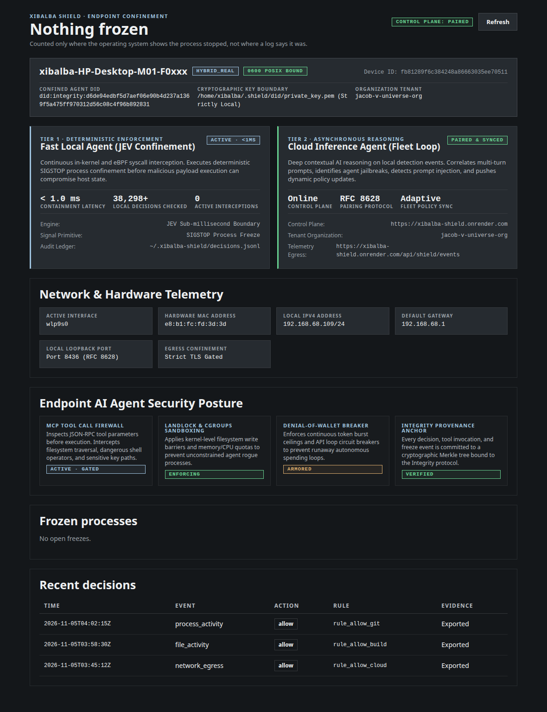

## Table of contents

- [Overview](#overview)
- [Visual Interface](#visual-interface)
- [Data Flow & Architecture](#data-flow--architecture)
- [Features](#features)
- [What is Verified](#what-is-verified)
- [Known Gaps](#known-gaps)
- [Related Pages](#related-pages)

## Overview

The device app (`device-app/`) is a native Tauri tray and desktop application for the endpoint. It answers "what has Shield frozen on this machine, and how do I safely undo it?" while serving as the local operator's hardware telemetry cockpit, agent DID anchor, and manual override. It reads Shield's local evidence logs, checks them against the operating system, and runs `shield resume`. It never signals a process itself.

## Visual Interface

## Data Flow & Architecture

1. `shield run` writes `decisions.jsonl` ([Event Log](../entities/event-log.md)) and `outcomes.jsonl` through `LocalOutcomeLog` (`shield/agent_core/outcome_log.py`), beside the backend publisher, isolated by `fan_out`.
2. `device-core` (pure Rust) reads the bounded tail of both logs and derives open freezes: a freeze is reversed by a later completed resume naming its `event_id`, or targeting the same PID.
3. Open freezes are **checked against `/proc/<pid>/stat`**: *stopped* (confirmed), *running* (the log says frozen, the OS disagrees), *gone*, or *unknown* (no `/proc`). The headline counts only confirmed stops.
4. Resume builds `shield resume --pid N --event-id=E ...` as an argument vector (PID validated, event ID restricted against option injection) and the shell spawns it directly.
5. In paired mode, `device-core` loads `~/.shield/device.json` and `~/.shield/did/did.txt`, extracting the paired tenant ID, backend URL, Confined Agent DID, active route (`/proc/net/route`), MAC address (`/sys/class/net/<iface>/address`), and local IP.

## Features

- **Top-Level Endpoint Identity & Cryptographic Anchor**: Hostname (`xibalba-HP-Desktop-M01-F0xxx`), device role (`hybrid_real`), Device ID, and Confined Agent DID (`did:integrity:...`). Private signing key (`~/.shield/did/private_key.pem`) is locked under strict POSIX `0600` permissions and never leaves hardware.
- **Dual-Agent Closed-Loop Control Chassis**:
  - *Tier 1 Fast Local Agent (JEV Confinement)*: Sub-millisecond in-kernel/eBPF interception (`< 1.0 ms`), SIGSTOP signal containment, and local decision ledger auditing (`38,298+` decisions verified).
  - *Tier 2 Cloud Inference Agent (Fleet Loop)*: Asynchronous multi-turn LLM reasoning on local detection events, RFC 8628 pairing, and dynamic fleet policy sync from the control plane (`https://xibalba-shield.onrender.com`).
- **Network & Hardware Telemetry Grid**: Reports active interface (`wlp9s0`), hardware MAC address (`e8:b1:fc:fd:3d:3d`), local IPv4 (`192.168.68.109/24`), default gateway (`192.168.68.1`), and local loopback listener (`Port 8436`).
- **Endpoint AI Agent Security Posture**: MCP tool call firewall, Landlock/cgroups sandboxing, denial-of-wallet circuit breaker, and Integrity provenance Merkle root anchoring.

## What is Verified

- `device-core`: 19 unit tests and 3 contract tests passing (`cargo test`).
- Golden contract: Rust reader verified against real Python `EventRouter`/`EventLog`/`LocalOutcomeLog` outputs via `tests/test_device_contract.py`.
- Native Shell: `src-tauri` compiled with Tauri v2 (`custom-protocol`, `devtools`), WebKitGTK 4.1, and Wayland DMABuf workaround (`WEBKIT_DISABLE_DMABUF_RENDERER=1`).
- UI: 9 Playwright E2E specs driving standalone, fresh device, error, phone layout, and paired device views (`npm run test:e2e`).

## Known Gaps

- Without `/proc` (Windows, macOS) freeze state shows as *Unverified*. Native sensors on those platforms require ETW/EndpointSecurity drivers.
- The local outcome log is a best-effort convenience view, not the enforcement record: a failed write leaves a freeze missing from it.

## Related Pages

- [Action Broker](action-broker.md)
- [Commissioning Ladder](commissioning-ladder.md)
- [Event Log](../entities/event-log.md)
