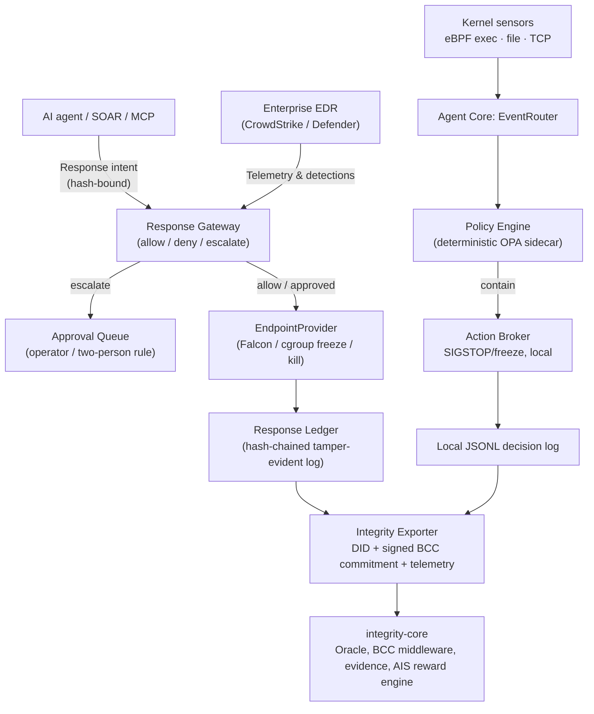

# Xibalba Shield Wiki

Xibalba Shield provides cryptographic topology, boundary gating, and verifiable response governance for autonomous AI agents and enterprise endpoints.

> **"The EDR detects and acts. Shield proves who authorized it, under what authority, and that the record is untampered."**

Shield enforces zero-probability state spaces for unauthorized operations and gates response intents across enterprise EDRs (CrowdStrike Falcon, Microsoft Defender) and agent runtimes. It is the boundary and response enforcement layer; `integrity-core` is the physics engine computing the Autonomous Integrity Score (AIS) as the native reward function; `xibalba-cortex` is the navigational knowledge engine; and `integrity-console` is the universal operator window.

Governance/conventions live in `WIKI_SCHEMA.md`; the full catalog with one-line descriptions is `WIKI_INDEX.md`; the change history is `WIKI_LOG.md`.

**Start here** if you're new:
[Enforcement Pipeline](architecture/enforcement-pipeline.md) (the end-to-end flow) →
[Ecosystem Role](architecture/ecosystem-role.md) (the four-repository physics & navigation architecture) →
[Action Broker & Response Governance](concepts/action-broker.md) (OS-level containment & EDR response gateway) →
[Policy Engine](concepts/policy-engine.md) (Tier 1 deterministic policy & OPA) →
[Exporter Remediation](concepts/exporter-remediation.md) (bounded exporter recovery) →
[Shield Detection Quality Metrics](concepts/shield-detection-quality-metrics.md) (ADR and false-positive measurements from labeled evidence) →
[SLM Cascade Tiers](concepts/slm-cascade-tiers.md) (what's real vs. `[PLANNED]` in the 3-tier architecture).

Production Cloud Console: [`https://xibalba-shield.onrender.com`](https://xibalba-shield.onrender.com)

## System at a glance

## Pages by category

### Concepts
- [Configurable Advisory Inference](concepts/advisory-inference.md)
- [Event Router](concepts/event-router.md)
- [Policy Engine](concepts/policy-engine.md)
- [Action Broker](concepts/action-broker.md)
- [Commissioning Ladder](concepts/commissioning-ladder.md)
- [Device App](concepts/device-app.md)
- [Guardrail Hooks](concepts/guardrail-hooks.md)
- [Integrity Exporter](concepts/integrity-exporter.md)
- [Shield Detection Quality Metrics](concepts/shield-detection-quality-metrics.md)
- [SLM Cascade Tiers](concepts/slm-cascade-tiers.md)
- [Sensor Model](concepts/sensor-model.md)
- [Exporter Remediation](concepts/exporter-remediation.md)

### Entities
- [Device Context & Agent Registry](entities/device-context.md)
- [Event Log](entities/event-log.md)

### Architecture
- [Ecosystem Role](architecture/ecosystem-role.md)
- [Enforcement Pipeline](architecture/enforcement-pipeline.md)

### Queries
- [Compliance Evidence Trail](queries/compliance-evidence-trail.md)
