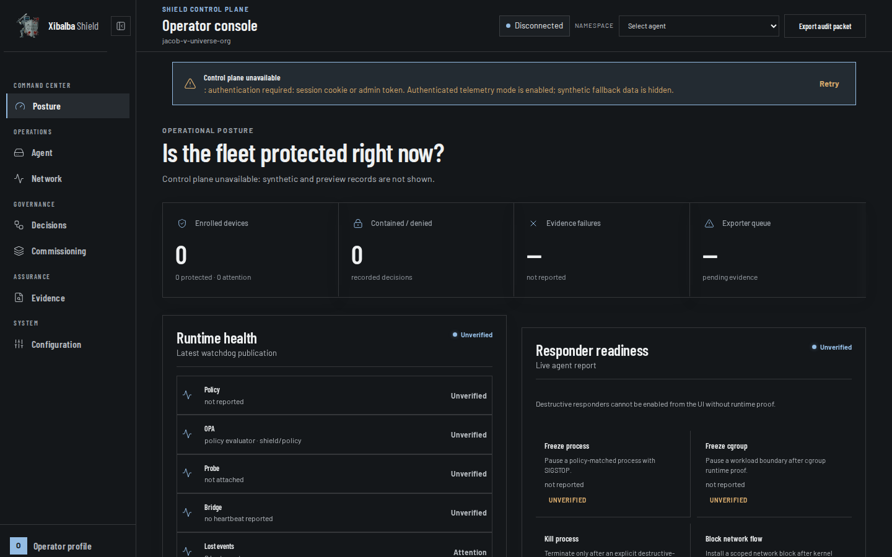
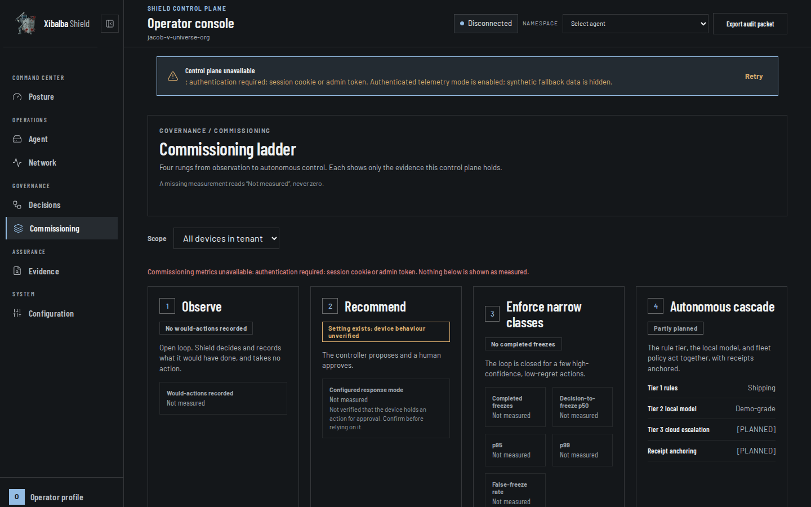

# Xibalba Shield Cloud Console

The web-based control plane and operator console for **Xibalba Shield**. Hosted in production at `https://xibalba-shield.onrender.com`.



## Overview

The Xibalba Shield Cloud Console provides centralized visibility, operational governance, and policy distribution across fleets of autonomous AI agent endpoints. It operates in tandem with the endpoint-local Shield runtime and the native Desktop App.

### Core Capabilities

- **Operational Posture Dashboard**: Immediate visibility into fleet health, active process containments, rule decisions, and evidence export pipeline health.
- **Device Commissioning & Pairing**: RFC 8628 Device Authorization Grant workflow allowing endpoints to pair securely with organization tenants using browser-based Google OAuth.
- **Dual-Tier Closed-Loop Fleet Intelligence**: Aggregates local detection events from endpoints, runs asynchronous contextual AI analysis, and redistributes signed policy updates.
- **Evidence Assurance**: Full cryptographic audit packet verification linked to the Integrity Protocol.

---

## Architecture & Views



### 1. Command Center: Operational Posture (`/`)
- **Fleet Protection Status**: Headline metric indicating real-time containment and security state across enrolled devices.
- **Runtime Health**: Live telemetry monitoring Policy Evaluator, Open Policy Agent (OPA), eBPF Kernel Probe, and IPC Bridge connectivity.
- **Responder Readiness**: Capability matrix showing enforcement status for process freezing (`SIGSTOP`), cgroup isolation, process termination, and scoped network blocking.

### 2. Operations: Agent & Network
- **Agent Matrix**: Real-time status of local endpoint agents, versioning, uptime, and last heartbeat timestamps.
- **Network Topology**: Sensor coverage over inbound/outbound flows, egress IP filtering, and API endpoint monitoring.

### 3. Governance: Decisions & Commissioning
- **Decision Stream**: Live ledger of allow/contain/deny decisions evaluated by local endpoint engines.
- **Commissioning Ladder**: Four progressive rungs of endpoint trust:
  1. *Observe*: Open-loop telemetry recording without enforcement.
  2. *Recommend*: Controller proposes containment actions requiring human operator approval.
  3. *Enforce Narrow Classes*: Closed-loop enforcement for high-confidence, low-regret action classes.
  4. *Autonomous Cascade*: Full autonomous defense combining local rules, fast edge models, and cloud fleet reasoning.

### 4. Assurance: Evidence & Audit Packets
- Downloadable cryptographic audit bundles signed with Ed25519 keys and verifiable against the Integrity Protocol ledger.

---

## Authentication & Device Pairing Flow

1. **Local CLI Initiation**: An operator runs `shield pair --backend-url https://xibalba-shield.onrender.com` on the endpoint.
2. **RFC 8628 Code Generation**: The endpoint requests a pairing code (e.g. `SHLD-226Z`) and starts a loopback listener on `http://127.0.0.1:8436`.
3. **Browser Authorization**: The operator signs in via Google OAuth on the Cloud Console and clicks *Authorize & Pair Device*.
4. **Loopback Callback**: The browser communicates with `http://127.0.0.1:8436/callback` to transfer the tenant authorization token.
5. **Local Confinement**: The endpoint saves configuration to `~/.shield/device.json` and locks down the private key under POSIX `0600` permissions.

---

## Development & Build

```bash
# Install dependencies
npm install

# Start Vite local development server
npm run dev

# Lint with Oxlint
npm run lint

# Build production bundle for static hosting
npm run build

# Preview production build locally
npm run preview
```

---

## Directory Structure

```
ui/
├── src/
│   ├── components/
│   │   ├── Dashboard.jsx         # Console layout & navigation framework
│   │   ├── Overview.jsx          # Operational posture dashboard
│   │   ├── CommissioningView.jsx # Device commissioning ladder & pairing
│   │   ├── ContainmentView.jsx   # Process containment & freeze status
│   │   ├── NetworkView.jsx       # Network sensor visualization
│   │   ├── EventStreamView.jsx   # Live decision audit log
│   │   ├── Landing.jsx           # Public product landing page
│   │   └── SignIn.jsx            # Authentication & tenant selection
│   ├── App.jsx                   # Session routing & OAuth callback handler
│   ├── api.js                    # Shield Cloud API client
│   └── storage.js                # Session management utilities
├── public/                       # Static branding assets & favicon
└── index.html                    # Root HTML document
```
