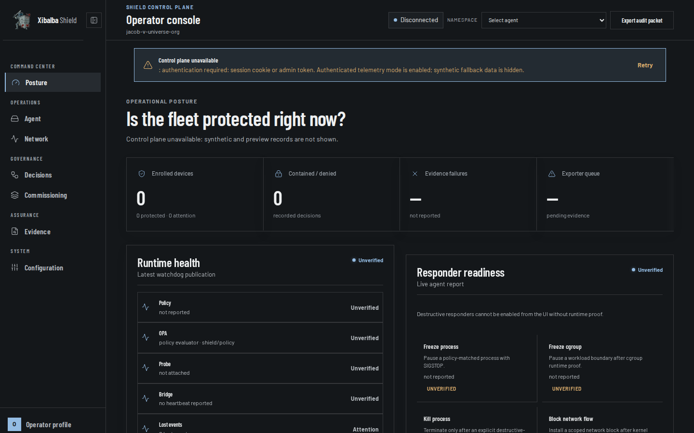

# Xibalba Shield Cloud Console

The web-based control plane and operator console for **Xibalba Shield**. Hosted in production at `https://xibalba-shield.onrender.com`.



## Overview

The Xibalba Shield Cloud Console provides centralized visibility, operational governance, and policy distribution across fleets of autonomous AI agent endpoints. It operates in tandem with the endpoint-local Shield runtime and the native Desktop App.

### Core Capabilities

- **Operational Posture Dashboard**: Immediate visibility into fleet health, active process containments, rule decisions, and evidence export pipeline health.
- **Device Commissioning & Pairing**: RFC 8628 Device Authorization Grant workflow allowing endpoints to pair securely with organization tenants using browser-based Google OAuth.
- **Dual-Tier Closed-Loop Fleet Intelligence**: Aggregates local detection events from endpoints, runs asynchronous contextual AI analysis, and redistributes signed policy updates.
- **Evidence Assurance**: Full cryptographic audit packet verification linked to the Integrity Protocol.

---

## Architecture & 5 Canonical Surfaces

The Shield Cloud Console is reimagined around 5 canonical operational surfaces matching the Integrity Console:

### 1. Command Center: Posture & Mesh (`overview`)
- **Fleet Protection Status**: Real-time headline containment, active threat counts, and zero-trust health across enrolled endpoints.
- **Runtime Health**: Live connectivity monitoring for Policy Evaluator, OPA daemon, eBPF/procfs kernel probes, and IPC bridges.
- **Agent0 Mesh Status**: Cryptographic identity states and active Base Sepolia ERC-8004 tokens for `shield.local` (#4) and `shield.cloud` (#5).

### 2. Governance: Policy Studio & OPA Engine (`policies`)
- **Interactive Policy Pack Studio**: Live in-browser Rego editor for editing, validating, and deploying policies.
- **Hot OPA Deployment**: Instantly pushes Rego updates via `PUT /v1/policies/<id>` to the active OPA engine.
- **Preselected Zero-Trust Bundles**: Rapid assignment between SMB, Professional Services, Regulated, and Custom profiles with audit-backed rollbacks.

### 3. Operations: Sensors & Network (`network`)
- **Real Linux Procfs Sensor**: Kernel `/proc/net/tcp` socket inspection with inode-to-PID mapping across `/proc/<pid>/fd`.
- **Live Event Stream**: Real-time stream of network and system events with interactive time range filtering.
- **Enrolled Endpoints**: Full hardware and OS attestation inventory for enrolled fleet devices.
- **Agent & Hermes Mesh**: Multi-agent telemetry linking local edge classification to cloud reasoning.

### 4. Security: Response & Containment (`response`)
- **Response Action Queue**: Pending approval queue for high-impact actions (kill process, drop flow, freeze cgroup) requiring human or two-person authorization.
- **Containment Outcomes Ledger**: Verifiable history of executed containment actions with cryptographic SHA-256 hashes.
- **Guardrails & Transaction Approvals**: Boundary enforcement controls and change governance queues.

### 5. System: System & Identity (`settings`)
- **System Posture & Operator Identity**: Tenant switching, admin token minting, and SMTP alert delivery configuration.
- **Subscription Billing & Plans**: Self-serve Free / Pro / Team catalog, Stripe customer portal, and resource usage gauges.
- **Commissioning & RFC 8628 Enrollment**: Endpoint onboarding ladder and pairing workflows.
- **SIEM & Connectors**: Export pipelines to enterprise SIEM/SOAR platforms.
- **Assurance & Audit Evidence**: Generation of cryptographic audit bundles verifiable against the Integrity Protocol.

---

## Authentication & Device Pairing Flow

1. **Local CLI Initiation**: An operator runs `shield pair --backend-url https://xibalba-shield.onrender.com` on the endpoint.
2. **RFC 8628 Code Generation**: The endpoint requests a pairing code (e.g. `SHLD-226Z`) and starts a loopback listener on `http://127.0.0.1:8436`.
3. **Browser Authorization**: The operator signs in via Google OAuth on the Cloud Console and clicks *Authorize & Pair Device*.
4. **Loopback Callback**: The browser communicates with `http://127.0.0.1:8436/callback` to transfer the tenant authorization token.
5. **Local Confinement**: The endpoint saves configuration to `~/.shield/device.json` and locks down the private key under POSIX `0600` permissions.

---

## Development & Build

```bash
# Install dependencies
npm install

# Start Vite local development server
npm run dev

# Lint with Oxlint
npm run lint

# Build production bundle for static hosting
npm run build

# Preview production build locally
npm run preview
```

---

## Directory Structure

```
ui/
├── src/
│   ├── components/
│   │   ├── Dashboard.jsx         # Console layout & navigation framework
│   │   ├── Overview.jsx          # Operational posture dashboard
│   │   ├── CommissioningView.jsx # Device commissioning ladder & pairing
│   │   ├── ContainmentView.jsx   # Process containment & freeze status
│   │   ├── NetworkView.jsx       # Network sensor visualization
│   │   ├── EventStreamView.jsx   # Live decision audit log
│   │   ├── Landing.jsx           # Public product landing page
│   │   └── SignIn.jsx            # Authentication & tenant selection
│   ├── App.jsx                   # Session routing & OAuth callback handler
│   ├── api.js                    # Shield Cloud API client
│   └── storage.js                # Session management utilities
├── public/                       # Static branding assets & favicon
└── index.html                    # Root HTML document
```
